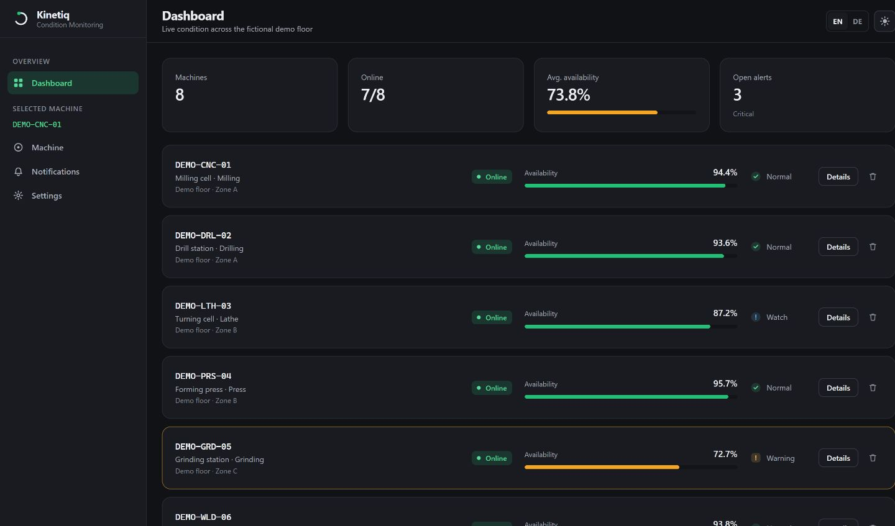
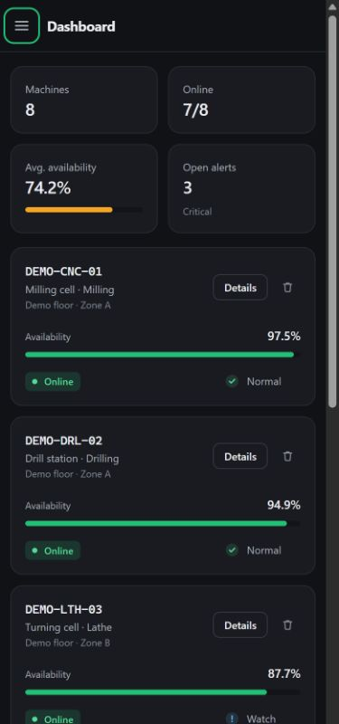
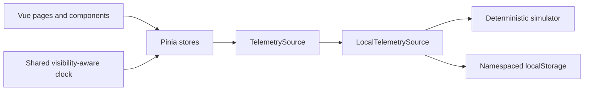

# Kinetiq

[](https://github.com/Saandu/kinetiq/actions/workflows/verify.yml)

Kinetiq is a browser-based condition-monitoring demo that shows which fictional factory machines need attention and when.

**Live demo:** [https://kinetiq-dashboard.web.app](https://kinetiq-dashboard.web.app)

Built by **[Alexandru Lungu](https://github.com/Saandu)** · Vue 3 · TypeScript · Pinia



This repository is a standalone 2026 portfolio project. All machine identities,
locations, telemetry, thresholds and events are fictional and generated for the
demo. The hosted demo uses browser-local data without authentication or API
calls. This repository also implements a separate local backend using simulated
devices, MQTT, SQS, PostgreSQL and a read API.

## Try it in two minutes

1. Open **Details** on a machine to inspect availability, operating states and
   illustrative maintenance windows. Page 2 includes an offline conveyor and a
   critical cooling pump.
2. Toggle maintenance mode or record a past maintenance action. Changes stay
   in your browser and survive a refresh.
3. Open **Settings**, rename an operating state or adjust the alert thresholds,
   then save that panel. Return to the dashboard to see the resulting severity.
4. Explore notification snapshots, switch English/German or light/dark mode,
   and try the mobile navigation.
5. Use **Settings → Reset demo data** to restore the starting data. No account,
   API key or setup is needed to explore the hosted demo.

## Background

This demo revisits a commercial project I built in 2023: the operator dashboard
for an industrial machine condition-monitoring system, delivered freelance for a
German manufacturer and deployed inside their plant.

That system read live sensor telemetry from real equipment out of an InfluxDB
time-series database, and published operator commands back to the factory over
MQTT - maintenance mode, fault logging, and the training hyperparameters of the
machine-learning model behind it. That made it a control surface rather than a
read-only report. Getting MQTT to work from a browser was the hardest part: the
protocol expects a raw TCP socket that browsers do not have, so it had to be
carried over WebSocket, with the Node-only client library polyfilled for the
bundler and the broker address resolved at runtime.

That codebase is private and client-owned. This repository shares none of its
code or data - it is a separate 2026 rebuild with fictional machines.

| | Paid client work, 2023 | Public portfolio rebuild, 2026 |
|---|---|---|
| Purpose | Operator dashboard for equipment inside the client's plant | Inspectable demonstration of the interface and engineering approach |
| Data | Real sensor telemetry with InfluxDB | Deterministic fictional telemetry |
| Controls | Operator commands published over MQTT | Local browser state only |
| Availability | Private, client-owned codebase | This repository and the hosted demo |

My contribution to the original project was the frontend and its integrations.
The public demo does not include the client's backend or machine-learning model.

## Engineering decisions

### A small interface without a UI framework

The application uses project-specific Vue components and hand-written CSS. That
uses Vue, Pinia, Vue Router, vue-i18n and shared Zod contracts,
and avoids shipping a general component or charting system for a compact,
fixed-purpose interface. The cost is that accessibility and responsive behavior
must be implemented and reviewed in the local components.

### One data boundary

Telemetry reads and writes go through the `TelemetrySource` interface. The local implementation combines a
deterministic telemetry source with namespaced `localStorage`, keeping storage
details out of the UI.

The browser-local and same-origin HTTP adapters are implemented. Stores own
loading, failure handling and protection against stale responses. The HTTP adapter
reads PostgreSQL through Fastify and validates responses against shared contracts.
The local backend is read-only; cloud authentication, writes and analytics remain
planned. The hosted demo keeps its browser-local adapter.

### Deterministic simulation

Generated values are derived from machine identity, field name and wall-clock
time. Reloading does not randomly move machines into unrelated states. At the
same time and with the same settings, generated values agree between tabs.
Explicit demo profiles ensure the dashboard
always contains a useful mix of healthy, warning, critical and offline states.

### One shared clock

A ref-counted timer updates one reactive timestamp and refreshes resolved
telemetry snapshots for the whole application. Polls do not overlap and updates
pause while the tab is hidden. Individual pages do not create polling loops.

### Visualisation follows the comparison

Operating-state distribution uses a stacked bar because the task is comparing
parts of a whole on a shared baseline. Ratios use simple meters. Severity is
also expressed with icon shape and text, so color is never the only signal.

## Stack

| Layer | Technology |
|---|---|
| UI | Vue 3 with TypeScript and `<script setup>` |
| State | Pinia |
| Routing | Vue Router |
| Internationalisation | vue-i18n, English and German |
| Styling and charts | Custom CSS and inline SVG |
| Build | Vite |
| Verification | Vitest, Vue Test Utils, TypeScript, GitHub Actions |
| Persistence | Browser `localStorage` |
| Hosting | Firebase Hosting as static files |

## Accessibility and mobile behavior

- Status combines color, icon shape and text.
- Interactive controls expose labels and focus-visible states.
- Reduced-motion preferences are respected.
- Touch targets expand on coarse pointers.
- Form controls use 16px text on touch devices because smaller controls cause
  iOS Safari to zoom the page on focus, which disrupts the layout.
- Drawers and dialogs lock and restore page scroll position.
- The mobile drawer contains keyboard focus, closes with Escape and restores
  focus. Closed navigation is inert; the page is inert while the drawer is open.
- A skip link leads directly to the main content.
- The layout accounts for dynamic mobile viewports and safe-area insets.

<details>
<summary>Mobile preview</summary>



</details>

## Run locally

Recommended: **Node.js 24.21.0 LTS (24.x)** and npm. `.nvmrc` selects Node 24.
The complete supported version range, including test tooling, is in `package.json`.

```bash
git clone https://github.com/Saandu/kinetiq.git
cd kinetiq
npm ci
npm run dev
```

Open [http://localhost:3100](http://localhost:3100).

```bash
npm run typecheck  # native TypeScript 7 and Vue template checks
npm test           # frontend, contract and real database tests (Docker required)
npm run verify     # database image, lint, builds, type checks and tests
npm run build      # type checks and production build in apps/web/dist/
npm run preview    # serve the built application locally
```

No environment file or Firebase account is required to run the frontend locally.

The Vue app lives in `apps/web`. Run npm commands from the repository root: npm workspaces shares one lockfile across the frontend, shared packages and backend services. Backend packages are added in Phase 0; the hosted demo keeps its local source until Phase 2.

`packages/contracts` defines and validates v1 telemetry batches and generates their JSON Schema. Its source and tests use TypeScript 7. Vue and ESLint retain the maintained TypeScript 6 compatibility API until their tooling supports the native API; see [the verified stack setup](docs/STACK_VERSIONS.md).

`packages/db` contains the Drizzle schema, SQL migrations, seed and tenant-safe transaction/ingest helpers. Full verification requires Docker with Linux containers; it builds PostgreSQL 18.6 with pg_partman and pg_cron and runs disposable Testcontainers tests. See [database details](packages/db/README.md) and [the implementation lesson](docs/lessons/PHASE_0_DATABASE.md). The frontend can still run independently with `npm run dev`; it is not connected to this database yet.

The local transport is implemented in `services/simulator`, `services/local-bridge` and `services/ingest`. Run `npm run services:images` to build and check their non-root production images. `npm run test:pipeline` starts disposable, authenticated Mosquitto, maintained LocalStack and PostgreSQL containers and verifies twelve-device delivery, retries, deduplication, broker ACLs and dead-letter redrive. This separate integration gate requires `LOCALSTACK_AUTH_TOKEN` in the root, Git-ignored `.env.local` or environment. Main-branch deployment now also requires its pipeline CI job and a dedicated CI Auth Token stored as the GitHub Actions secret `LOCALSTACK_AUTH_TOKEN_CI`; the workflow maps it to `LOCALSTACK_AUTH_TOKEN`. The local developer token is not uploaded automatically. See [the messaging lesson](docs/lessons/PHASE_0_MESSAGING.md). The read API, HTTP dashboard adapter and complete Compose acceptance are implemented. See [the API and Compose lesson](docs/lessons/PHASE_0_API_AND_COMPOSE.md).

## Verification and source tour

The [CI/CD workflow](.github/workflows/verify.yml) runs on branch pushes and pull
requests. It installs from the lockfile, runs `npm run verify`, and checks
production dependencies for high/critical advisories. A push or merged PR to
`main` then deploys the verified build to Firebase Hosting. Other branches and
pull requests cannot deploy. See [deployment details](docs/DEPLOYMENT.md).

The tests cover independent settings saves, immediate severity updates, invalid
thresholds, deterministic data, persistence and reset, blocked/corrupt storage,
shared timer cleanup, hidden-tab behavior and mobile drawer focus/scroll recovery.
Async tests also cover stale responses after navigation, failed reads and writes,
retry, duplicate-write prevention, settings drafts and success notifications.

They also cover the interface primitives, because the accessibility claims above
are the kind that quietly stop being true: that a field label is wired to the
control in its slot, that the switch is a `role="switch"` with `aria-checked`
rather than a styled div, that each severity draws its own *shape* and not only
its own colour, and that a dialog names itself, takes focus in, keeps Tab
inside, closes on Escape and hands focus back to whatever opened it.

See [the test suite](apps/web/tests) and [the browser checklist](docs/VERIFICATION.md).
These checks are not a claim of exhaustive browser or accessibility coverage.

| Start here | What to inspect |
|---|---|
| [`telemetryService.ts`](apps/web/src/services/telemetryService.ts) | Data contract, local adapter and stored-data normalization |
| [`simulator.ts`](apps/web/src/services/simulator.ts) | Stable generated values and deliberate demo profiles |
| [`fleet.ts`](apps/web/src/stores/fleet.ts) | Shared reactive clock, lifecycle and derived fleet status |
| [`settings.ts`](apps/web/src/stores/settings.ts) | Draft state, per-panel saves and validation |
| [`components/ui`](apps/web/src/components/ui) | 14 reusable interface primitives, covered by [`components.test.ts`](apps/web/tests/components.test.ts) |
| [`tokens.css`](apps/web/src/styles/tokens.css) | Shared typography, spacing, color and theme tokens |



The Vue app has four **direct runtime dependencies**. The build output reports gzip
sizes per file, including shared and lazy-loaded route chunks; a single main
bundle measurement should not be presented as the size of the whole app.

## Known limitations

- Telemetry is illustrative and should not be used for operational decisions.
- Browser storage is local to one device and can be cleared at any time.
- The demo has no multi-user workflow, authentication or server-side history.
- Alert configuration affects generated demo severity only.
- Mode switches record local intent; they do not stop equipment or a real feed.
- Local edits are not synchronized across tabs or devices.
- Prediction windows are illustrative, not the output of a predictive model.

## Copyright and permissions

Copyright (c) 2026 Alexandru Lungu. All rights reserved.

The source is public for portfolio review; this is not an open-source project.
Reuse, modification and redistribution require prior written permission,
except where applicable law or GitHub's Terms of Service permit otherwise.
Third-party dependencies and materials retain their own licenses.
See [LICENSE](LICENSE) for the full notice and permission requests.

## Run the local backend

With Docker Desktop running, put only the developer `LOCALSTACK_AUTH_TOKEN` in
an ignored `.env.local` at the repository root. Then run:

```sh
npm run local:up
npm run local:verify
```

Open http://127.0.0.1:3101. Twelve fictional devices publish through authenticated
MQTT into SQS; ingest stores readings and the dashboard reads them through the
local API. Analytics remain unavailable until a scorer exists. Availability is
online share among received samples over 24 hours, not measured uptime during
gaps. Backend controls are read-only; the browser-only demo keeps its local controls.

`npm run local:down` stops the stack and preserves PostgreSQL and broker volumes.
Local emulator queues are recreated on bootstrap. Do not use `down -v` when
preserving local data. Images exclude env files and use pinned upstream digests.
The API and database have no published ports; the web port binds to loopback.

## Local Kubernetes foundation

With Docker Desktop running on Windows x64:

```sh
npm run k8s:tools
npm run k8s:up
npm run k8s:images
npm run k8s:verify
```

Tools and cluster credentials are stored in ignored `.tools/k8s` on the repository
drive. Setup verifies pinned download checksums. The single k3d node has an 8 GiB
memory cap; API and future ingress ports bind to loopback. `npm run k8s:stop`
preserves the cluster; `npm run k8s:up` starts it again. Application deployment,
operators and backup restoration are subsequent Phase 1 steps. The dashboard
currently runs through Compose. See the [cluster lesson](docs/lessons/PHASE_1_CLUSTER.md).

The application chart can now be checked without starting Kubernetes:

```sh
npm run helm:verify
npm run helm:smoke
```

Both local and CI profiles undergo strict schema, security, network-rule and
memory-budget checks. The smoke command also checks Nginx configuration in the
real web image. The chart requires database/platform provisioning before it can
run the full pipeline; rendered objects do not establish runtime readiness or
policy enforcement. See the [Helm lesson](docs/lessons/PHASE_1_HELM.md).
