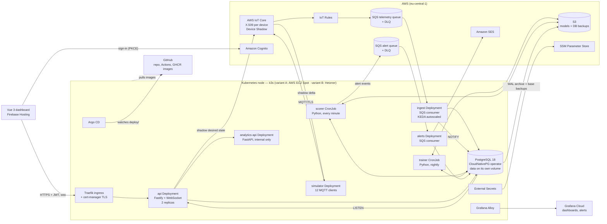

# Kinetiq: production build plan

Status: Phase 0 implementation beginning. Written 3 October 2026, revised 5 October 2026 (revision 4; see the change log at the end).
Owner: Alexandru Lungu. Intended reader: the coding agent (Claude Code or Codex) working in this repository, and me.
Companion: [LEARNING_GUIDE.md](LEARNING_GUIDE.md) explains every concept in this plan from zero. Read the matching guide section before building each piece.

This document turns Kinetiq from a frontend-only demo into a complete, production-style system: simulated devices talking MQTT to AWS, Node.js/TypeScript services, a Python analytics service, PostgreSQL, authentication with roles, live updates and alerting. Every service is a Docker container running on Kubernetes, deployed through CI/CD and GitOps, with infrastructure as code, observability, a measured load test and a measured recovery drill, on a budget of under $20 a month. Read all of it before writing code. Work phase by phase; each phase ends deployed, tested and documented.

---

## 0. Why this project, and what it must prove

All six of my production systems run on Supabase or Firebase. The roles I am applying for (full-stack, product engineering, consulting delivery) keep asking for **Node.js, AWS, a custom API, PostgreSQL, Docker, Kubernetes, CI/CD and often Python**. Kinetiq is the right place to show that, because industrial condition monitoring is a genuinely backend-heavy domain: device ingestion, time-series storage, analytics, alerting, commands back to equipment and live dashboards.

After this project I must be able to say, truthfully and with links:

1. I designed and built an event-driven backend on AWS without a backend-as-a-service: MQTT device ingestion, queues, workers, an API, a relational database and scheduled jobs.
2. I packaged every service as a container and run them on Kubernetes that I operate myself: Helm, ingress with TLS, autoscaling on queue depth, CronJobs, network policies, a PostgreSQL operator with continuous backups, secrets from a cloud store, and GitOps deploys with Argo CD.
3. I wrote a Python service that does real analytics (anomaly detection and health scoring) and measured how well it works, on simulated faults and on a public real-world dataset.
4. Everything is created from code, deployed by CI with no stored cloud keys, monitored, alarmed and cost-capped. The server is disposable: I terminate it on purpose and measure how long the system takes to rebuild itself, database included.
5. Authorization is enforced on the server and in the database, with roles and multi-tenancy.
6. The numbers in the README (latency, throughput, detection quality, recovery time, monthly cost) were measured, not estimated.
7. I made deliberate cost decisions and can explain what each one trades away.

### Non-goals

- No LLM or generative-AI features. This project is about backend, data and infrastructure. Classic machine learning only.
- No React rewrite. The Vue 3 frontend stays; it becomes a real client of the API.
- No client code or data from the 2023 commercial project. Everything stays fictional. Keep the README's background section and its disclaimer.
- No "production" claims that are not true. This is a reference system with simulated devices, run at small scale on a single Kubernetes node. The README says exactly that, and has a "What production would still need" section.
- No complexity I cannot explain. Every component must have a sentence in the decisions table and a section in the learning guide.

---

## 1. Target architecture

The Kubernetes node runs either on AWS EC2 Spot (variant A) or on Hetzner Cloud (variant B). The choice is made before Phase 2; see Section 9. Everything else is the same in both.



### Data flow in one paragraph

Each simulated machine is an MQTT client with its own X.509 certificate. It samples every 10 seconds and, once a minute, publishes the six readings as one batch (temperature, vibration, spindle speed, power, operating state) to `kinetiq/{site}/{machine}/telemetry` on AWS IoT Core. An IoT Rule forwards messages to an SQS queue. The `ingest` service, a long-running Node.js container, long-polls the queue, validates batches, inserts them into a partitioned PostgreSQL table through a small connection pool, and sends a Postgres `NOTIFY`; every `api` pod `LISTEN`s and pushes the latest values to browsers connected over WebSocket. KEDA adds `ingest` replicas when the queue grows. PostgreSQL runs inside the cluster, managed by the CloudNativePG operator, which streams its write-ahead log and nightly base backups to S3. Every minute a Kubernetes CronJob runs the Python scorer: it scores each machine's recent window for anomalies and writes a health record; nightly, another CronJob retrains a per-machine model and stores it in S3. When a score crosses the machine's thresholds, the scorer sends an alert event to a second queue; the `alerts` service records it, emails subscribed users and notifies the dashboard. Operators sign in with Cognito, read data through the Fastify API and send commands (maintenance mode, monitoring on/off) that the API writes to the machine's Device Shadow; the simulator applies the change and reports it back, and the UI shows the command moving from "pending" to "applied". Everything inside the cluster is declared in a Helm chart in this repository; Argo CD keeps the cluster equal to what `main` says.

### Why each choice (keep these in the README's decisions section)

| Decision | Choice | Why | Alternative rejected |
|---|---|---|---|
| Device protocol | MQTT over TLS to AWS IoT Core | What the original product used and what industrial equipment speaks; per-device certificates, policies and Device Shadow | HTTP POST from devices: not how equipment works; self-hosted broker (loses the managed IoT story) |
| Message batching | Devices sample every 10 s and publish one batch per minute | IoT Core bills per message; batching cuts messages 6× (~$3-5 → under $1/month). Real condition-monitoring devices batch too. Cost: dashboard values update once a minute, which suits monitoring (not machine control) | One message per sample |
| Buffer between devices and DB | IoT Rule → SQS → ingest service | Back-pressure, retries, a dead-letter queue and batch inserts; readings survive the node being down | IoT Rule straight to the DB: no buffer, no retries |
| Database | PostgreSQL 18 in the cluster, run by the **CloudNativePG** operator; continuous backup to S3 (Barman Cloud); native partitioning + `pg_partman` + `pg_cron` | Saves ~$15/month versus RDS; shows operating a database on Kubernetes, backups and point-in-time recovery; partitioning and retention are real time-series techniques | RDS `db.t4g.micro` (~$15/month; the right choice with a real budget, named in the README); Timestream for InfluxDB (closest to the original 2023 stack, but shows less SQL and costs more) |
| Runtime | Docker containers on **k3s** (certified lightweight Kubernetes) on one 4 GB ARM server | One runtime for every service; long-running services keep connection pools; I learn and operate real Kubernetes | AWS Lambda (cheaper idle, but no Kubernetes and one DB connection per invocation); EKS (~$73/month control plane); GKE (free control plane, but node + load balancer + database cost $25-50/month, and Google has had no IoT Core since 2023) |
| Hosting | **Open: variant A (AWS EC2 Spot, ~$15-18/month) or variant B (Hetzner, ~$7-10/month)**. Decide before Phase 2 (Section 9) | Both keep the full architecture; they differ in cost and in how much of the CV says "AWS" | On-demand EC2 + RDS (~$55-65/month, over budget) |
| Node lifecycle | Disposable: rebuilt from code; database data on a separate volume plus S3 backups | If the server dies or Spot reclaims it, a new one rebuilds itself from git. Measured in a recovery drill | A hand-built "pet" server |
| Packaging | One Helm chart, environment values files (`local`, `ci`, `prod`) | Same chart on my laptop (k3d), in CI and in the cloud | Raw YAML per environment (drifts) |
| Deployment | GitOps with Argo CD; CI only builds images and bumps the image tag in git | Git is the single source of truth; rollback = revert a commit; CI never needs cluster credentials | `helm upgrade` from CI (push-based, CI needs cluster access) |
| Ingress and TLS | Traefik (ships with k3s) + cert-manager with Let's Encrypt | Free TLS certificates, renewed automatically | A cloud load balancer (~$16-20/month idle) |
| Autoscaling | KEDA scaling `ingest` on SQS queue depth; HPA on CPU for `api` | Scales on the signal that matters (work waiting) | Fixed replica count |
| Scheduled jobs | Kubernetes CronJobs | Native, visible in `kubectl`, history kept | EventBridge Scheduler (no Kubernetes learning) |
| Live updates | WebSocket in the `api` pods; Postgres `LISTEN/NOTIFY` fans out between replicas | No extra infrastructure | Redis pub/sub (another component); API Gateway WebSocket |
| Analytics | Python 3.14 container (numpy, pandas, scikit-learn, FastAPI) | Right language for time-series analysis and ML | Analytics in Node |
| Auth | Cognito user pool (free tier), groups `operator`, `engineer`, `admin`; managed login with PKCE; JWT verified in the API with `aws-jwt-verify` | Standard on AWS, no passwords in my code | Rolling my own auth |
| Secrets | External Secrets Operator syncing from **SSM Parameter Store** (SecureString, standard tier) | Free; no secrets in git or Helm values | Secrets Manager (~$0.40 per secret per month; named in the README as the upgrade) |
| Pod permissions to AWS | Per-service IAM roles via self-hosted **IRSA** (cluster OIDC issuer published to S3), from Phase 2 | Least privilege per service; works from any cloud, so both hosting variants use it | Static access keys in Kubernetes secrets; one shared node role |
| Container registry | GitHub Container Registry (GHCR), public images | Free; the source is already public | Amazon ECR (~$0.10/GB-month; named as the AWS-native option) |
| Infrastructure | AWS CDK v2 in TypeScript for AWS resources; Terraform for the Hetzner server in variant B | CDK keeps one language for AWS; Terraform is the standard for non-AWS providers | Console clicking |
| Observability | OpenTelemetry + Prometheus metrics in every service, Grafana Alloy → Grafana Cloud free tier; CloudWatch alarms for AWS-managed resources | Industry-standard Kubernetes observability without running Prometheus on a 4 GB node | Self-hosted kube-prometheus-stack (~1.5-2 GB RAM) |
| CI auth to AWS | GitHub Actions OIDC → IAM roles | No stored keys; mirrors the existing Workload Identity Federation for Firebase | Access keys in GitHub secrets |
| Region | `eu-central-1` (Frankfurt) for AWS; Falkenstein/Nuremberg for Hetzner | EU data residency; fits the German-manufacturer background | - |

Verify every price and service availability with the providers' current pricing pages before building. The numbers here are planning estimates. Runtime and platform release baselines, checked on 5 October 2026, are in [STACK_VERSIONS.md](STACK_VERSIONS.md). Node uses the latest LTS line; tools without LTS tracks use stable supported releases, never prereleases. Keep the full planned scope. Validate each platform version against its dependencies before installing it.

---

## 2. Repository layout after the change

An npm workspaces monorepo, plus one Python project managed with `uv`.

```
kinetiq/
  apps/
    web/                     # the existing Vue 3 app, moved here unchanged first
  services/
    api/                     # Fastify API + WebSocket (TypeScript) + Dockerfile
    ingest/                  # SQS → Postgres worker (TypeScript) + Dockerfile
    alerts/                  # alert worker (TypeScript) + Dockerfile
    simulator/               # device simulator (TypeScript) + Dockerfile
    analytics/               # Python: scorer, trainer, FastAPI + Dockerfile
  packages/
    contracts/               # Zod schemas → OpenAPI → generated TS types; telemetry message schema
    db/                      # Drizzle schema, SQL migrations, seed, test helpers, migration image
    config/                  # shared tsconfig, eslint, vitest presets
  deploy/
    charts/kinetiq/          # Helm chart for all Kinetiq services
    platform/                # Argo CD Applications: cert-manager, KEDA, External Secrets, CloudNativePG, Alloy
    environments/
      local/values.yaml      # k3d on my laptop: LocalStack instead of AWS, local MQTT broker
      ci/values.yaml         # throwaway k3d cluster in GitHub Actions
      prod/values.yaml       # the cloud node; image tags bumped by CI
    bootstrap/               # node first-boot script (cloud-init), Argo CD root application
  infra/
    aws/                     # AWS CDK app (TypeScript) + tests
    hetzner/                 # Terraform for the Hetzner server (variant B only)
  load/                      # k6 scripts and saved results
  docs/
    PRODUCTION_PLAN.md       # this file
    LEARNING_GUIDE.md        # concepts explained from zero
    ARCHITECTURE.md          # final architecture, written at the end of Phase 2 and kept current
    RUNBOOK.md               # alarms, what they mean, what to do; includes node and database recovery
    COSTS.md                 # measured monthly cost
    DEPLOYMENT.md            # updated for the new pipeline
    VERIFICATION.md
  docker-compose.yml         # fast local development: Postgres, Mosquitto, LocalStack (SQS), all services
  .github/workflows/         # verify, release, infra, deploy-web
```

Moving the web app to `apps/web` is the first commit of Phase 0, done on its own, with `firebase.json`, the workflow and all existing tests updated so nothing else changes. All existing tests must keep passing at every step.

### Two ways to run locally, on purpose

- **`docker compose up`**: everyday development. Fast to start, hot reload, no Kubernetes. Postgres, Mosquitto (MQTT broker) and LocalStack (a local imitation of SQS and S3) in containers.
- **`npm run k8s:up`**: creates a k3d cluster (k3s inside Docker) and installs the platform add-ons and the Helm chart with `local` values, including CloudNativePG backing up to LocalStack S3. Used to develop and test the chart. Same chart as production.

Laptop requirement: Docker Desktop with WSL 2 and about 8 GB of memory available to it for the k3d cluster with everything running. `docker compose` alone needs less.

---

## 3. Data model (PostgreSQL)

Write migrations as SQL (Drizzle Kit generates the base; partitioning, RLS, functions and extensions are hand-written SQL in the same migration folder). Every table has `created_at timestamptz default now()`. Tenant-owned rows also carry `organization_id` where omitted from the abbreviated tables below; composite foreign keys bind that value to the parent machine, site or user.

### Tenancy and identity

| Table | Columns (main) | Notes |
|---|---|---|
| `organizations` | `id uuid pk`, `name` | The demo has one organization; the model supports many |
| `sites` | `id`, `organization_id`, `name`, `timezone` | e.g. "Werk Nord", fictional |
| `app_users` | `id`, `cognito_sub unique`, `organization_id`, `email`, `display_name`, `role` (`operator`/`engineer`/`admin`) | Role mirrors the Cognito group; the API reads the group from the JWT and the org from this table |
| `audit_log` | `id`, `organization_id`, `user_id`, `action`, `entity`, `entity_id`, `payload jsonb`, `at` | Every write through the API appends here |
| `idempotency_keys` | `key`, `user_id`, `request_hash`, `response jsonb`, `created_at` | Stored results of POSTs, kept 24 h |

### Machines and devices

| Table | Columns | Notes |
|---|---|---|
| `machines` | `id text pk` (e.g. `mill-01`), `organization_id`, `site_id`, `name`, `kind` (matches `MachineKind`), `location`, `hidden bool` | Same ids as the current simulator, so the UI's fixtures still make sense |
| `devices` | `thing_name pk`, `machine_id unique`, `certificate_id`, `last_seen_at` | One IoT thing per machine |
| `machine_settings` | `machine_id pk`, `state_names text[8]`, `watch_below`, `warning_below`, `critical_below`, `updated_by`, `updated_at` | Replaces the browser-only settings |
| `model_settings` | `machine_id pk`, `method` (`zscore`/`isolation_forest`), `window_minutes`, `zscore_threshold`, `contamination`, `min_confidence`, `updated_by`, `updated_at` | The "model hyperparameters" operators tuned in the original product. Engineers and admins only |
| `machine_modes` | `machine_id pk`, `maintenance_mode`, `monitoring_enabled`, `desired_version`, `reported_version`, `updated_at` | Mirrors the Device Shadow; the UI shows pending while desired ≠ reported |

### Telemetry and derived data

| Table | Columns | Notes |
|---|---|---|
| `telemetry` | `machine_id`, `ts timestamptz`, `temperature_c real`, `vibration_mm_s real`, `spindle_rpm real`, `power_kw real`, `state_index smallint`, `online bool`, `received_at` | **Partitioned by range on `ts`, daily partitions** via `pg_partman`; primary key `(machine_id, ts)`; retention 30 days raw. Inserts are idempotent (`on conflict do nothing`) because SQS is at-least-once |
| `telemetry_hourly` | `machine_id`, `hour`, avg/min/max per metric, `samples`, `online_share`, `state_share real[8]` | Rollup kept for a year; maintained by a `pg_cron` job every 5 minutes for the open hour and once for the closed hour |
| `machine_health` | `machine_id`, `ts`, `method`, `anomaly_score real` (0-100), `health_score real` (0-100), `confidence real` (0-1), `contributors jsonb`, `model_version` | Written by the Python scorer every minute. Partitioned monthly |
| `predictions` | `machine_id`, `computed_at`, `metric`, `threshold`, `eta timestamptz null`, `slope`, `r2` | Time-to-threshold forecast for "next maintenance" |
| `alerts` | `id`, `machine_id`, `level` (0-3, matches `AlertLevel`), `kind` (`availability`/`anomaly`/`offline`/`forecast`), `message_key`, `value`, `snapshot jsonb`, `opened_at`, `resolved_at`, `dedupe_key` | Partial unique index on `dedupe_key where resolved_at is null` stops repeated alerts for the same open condition |
| `alert_dismissals` | `alert_id`, `user_id`, `at` | Dismissal is per user, as in the current UI |
| `maintenance_entries` | `id`, `machine_id`, `category` (matches `FaultCategory`), `at`, `note`, `created_by` | Replaces the local "add fault data" action |
| `fault_events` | `id`, `machine_id`, `category`, `started_at`, `ended_at`, `source` (`simulator_injected`/`operator`) | Ground truth for the analytics evaluation |

Storage estimate: 12 machines × 8,640 rows/day × 30 days ≈ 3.1 M telemetry rows, roughly 0.5-1 GB with indexes, plus a year of hourly rollups (~100 k rows). A 10 GB data volume leaves ample room.

### Security inside the database

- Row Level Security on every tenant table, keyed on `current_setting('app.organization_id')`, with `FORCE ROW LEVEL SECURITY` so the table owner is also subject to it. The API sets the value with `set local` inside every transaction (never plain `set`, which would leak across pooled connections). The API also filters by organization in every query; RLS is defense in depth, and tests prove a query without the setting returns nothing and a pooled connection does not keep the previous request's organization.
- Database roles: `kinetiq_api` (read/write tenant data, RLS enforced), `kinetiq_ingest` (insert into `telemetry`, read only its conflict-key columns for idempotent inserts, read device identity/last-seen columns, update only `devices.last_seen_at`, and `NOTIFY`), `kinetiq_analytics` (read telemetry and settings, write `machine_health`, `predictions`, read/write `fault_events`), `kinetiq_alerts` (write `alerts`). No service uses the superuser at runtime.
- Credentials: CloudNativePG declares the roles (managed roles) with generated passwords stored as Kubernetes Secrets in the cluster; each service mounts only its own. The superuser secret is used only by the migration Job. Connections require TLS (CloudNativePG issues the certificates).
- Network: Postgres has no external Service and no public port. A NetworkPolicy allows connections only from the service pods and the migration Job.
- Connection budget: `max_connections = 100`. Each service has a fixed pool size (`api` 5 per replica + 1 LISTEN connection, `ingest` 3 per replica, `alerts` 2, analytics 2) and maximum replicas are capped in Helm. A test computes the worst-case total from the values files and fails above 60.

### Backups and recovery

- CloudNativePG continuously archives the write-ahead log (WAL) to S3 with `archive_timeout` of 5 minutes, and takes a base backup nightly. Backups are kept 7 days (S3 lifecycle rule). Recovery point objective: at most 5 minutes of writes, and telemetry from that window is usually still recoverable because SQS keeps messages until ingest deletes them.
- Database data lives on its own volume, separate from the server's disk, so replacing the server does not delete it.
- Node replacement: the new server reattaches the data volume and CloudNativePG resumes on the existing data. **Phase 1 includes a spike to prove this path works**; if it cannot be made reliable, the Cluster bootstraps by restoring from S3 instead and the README states the 5-minute recovery point.
- A monthly restore test (CronJob) restores the latest backup into a temporary cluster and runs a row-count check; failure raises an alert. A backup that has never been restored is not a backup.

---

## 4. Contracts

### MQTT

- Telemetry topic: `kinetiq/{siteId}/{machineId}/telemetry`, QoS 1.
- Payload: one batch per minute (configurable for load tests), validated by Zod in `packages/contracts` and by Pydantic in analytics; one JSON Schema generated from the Zod schema is the source of truth for both:

```json
{
  "v": 1,
  "machineId": "mill-01",
  "seq": 3039,
  "readings": [
    { "ts": "2026-10-03T12:00:00.000Z", "online": true, "state": 3,
      "metrics": { "temperatureC": 61.2, "vibrationMmS": 2.41, "spindleRpm": 11850, "powerKw": 7.9 } },
    { "ts": "2026-10-03T12:00:10.000Z", "online": true, "state": 3,
      "metrics": { "temperatureC": 61.3, "vibrationMmS": 2.44, "spindleRpm": 11850, "powerKw": 8.0 } }
  ]
}
```

  Six readings per message stays well under IoT Core's 5 KB billing unit.
- Device Shadow (named shadow `modes`): desired `{ maintenanceMode, monitoringEnabled, version }`, reported the same. The simulator subscribes to the shadow delta, applies the change immediately (not batched), reports back. A second IoT Rule forwards reported shadow updates to the telemetry queue as a different message type so `ingest` updates `machine_modes.reported_version`.
- IoT policy: each certificate may connect only as its own thing name and publish/subscribe only under its own topic prefix and shadow (`${iot:Connection.Thing.ThingName}` policy variables). A test asserts the policy contains no wildcard publish.

### HTTP API (Fastify, OpenAPI generated from Zod with `fastify-type-provider-zod`)

All routes under `/v1`, all require a Cognito JWT verified in the API, all scoped to the caller's organization, except those marked public.

| Method and path | Role | Purpose | Maps to current `TelemetrySource` method |
|---|---|---|---|
| `GET /machines` | any | Roster | `listMachines` |
| `GET /machines/status` | any | Rolled-up status per machine (availability over 24 h, alert level, online) | `listStatuses` |
| `GET /machines/:id/telemetry` | any | Everything the detail view renders | `getTelemetry` |
| `GET /machines/:id/series?metric=&from=&to=&bucket=` | any | Chart data from raw or hourly table, chosen by range | new |
| `GET /machines/:id/health?from=&to=` | any | Health and anomaly history, with contributors | new |
| `GET /machines/:id/alerts` | any | Alerts / notifications | `listNotifications` |
| `POST /alerts/:id/dismiss` | any | Per-user dismissal | `dismissNotification` |
| `PATCH /machines/:id/hidden` | admin | Hide/restore from roster | `removeMachine` / `restoreAllMachines` |
| `PUT /machines/:id/modes` | operator+ | Maintenance mode / monitoring; writes the Device Shadow; returns 202 with the desired version | `setMaintenanceMode` / `setMonitoringEnabled` |
| `GET /machines/:id/settings`, `PUT /machines/:id/settings` | read any, write engineer+ | State names, thresholds | `getSettings` / `saveSettings` |
| `GET /machines/:id/model`, `PUT /machines/:id/model` | read any, write engineer+ | Analytics settings; PUT triggers a recompute via the analytics service | new |
| `GET /machines/:id/maintenance`, `POST /machines/:id/maintenance` | read any, write operator+ | Maintenance entries | `listMaintenanceEntries` / `addMaintenanceEntry` |
| `GET /me` | any | Profile, role, organization | new |
| `POST /demo-session` | public, rate-limited | Signs in one of the two demo accounts server-side (Cognito `AdminInitiateAuth`) and returns its tokens, so the "Enter as operator / engineer" buttons work in one click without demo passwords in the frontend | new |
| `GET /public/status` | public, cached 10 s | Read-only fleet overview for visitors who do not sign in | new |
| `GET /ws` | any (token on connect) | WebSocket upgrade for live updates | new |
| `GET /healthz`, `GET /readyz` | public | Liveness (process up) and readiness (DB reachable); used by Kubernetes probes | new |
| `GET /metrics` | cluster-internal only | Prometheus metrics; blocked at the ingress | new |

Conventions: RFC 9457 problem+json errors; cursor pagination on lists; `ETag` + `If-None-Match` on status reads; `Idempotency-Key` header on POSTs (stored in `idempotency_keys`); request ID in every log line and response header; rate limits: Traefik middleware per IP at the edge, plus per-user write limits in the app stored in Postgres (an in-memory limit would multiply by the number of replicas).

### Analytics internal API (FastAPI, ClusterIP service, reachable only from `api` pods by NetworkPolicy)

| Route | Purpose |
|---|---|
| `POST /recompute/{machine_id}` | Re-score the last window immediately after model settings change |
| `GET /explain/{machine_id}?at=` | Per-feature contributions for one score (feeds the "why flagged" panel) |
| `POST /backtest` | Run the evaluation on stored data with given settings; returns precision, recall, detection delay |

---

## 5. The Python analytics service (what it does and why)

This replaces the fake `anomalyScore`, `confidence` and predicted maintenance windows in today's simulator with real computations. It mirrors the original product, which had a machine-learning model whose hyperparameters operators tuned from the dashboard.

### Package layout (`services/analytics`)

```
analytics/
  pyproject.toml              # uv; Python 3.14; ruff; mypy --strict; pytest
  src/kinetiq_analytics/
    features.py               # windowing, rolling stats, resampling (pandas/numpy)
    detectors/
      zscore.py               # rolling robust z-score (median/MAD), per metric
      isolation_forest.py     # scikit-learn IsolationForest on window features
    health.py                 # anomaly score → health score + confidence; contributors
    forecast.py               # linear trend on vibration/temperature → time to threshold
    alerts.py                 # threshold logic + dedupe keys; emits events to SQS
    evaluation.py             # backtest against fault_events ground truth
    benchmarks/ims.py         # loader for the NASA IMS bearing dataset (public, external benchmark)
    db.py                     # SQLAlchemy 2.0 Core + psycopg 3
    models_store.py           # joblib models in S3, versioned
    cli.py                    # entry points: `score`, `train`, `eval`, `serve`
    api.py                    # FastAPI app (uvicorn)
  tests/                      # pytest; Testcontainers Postgres; hypothesis for features
  Dockerfile                  # multi-stage; python:3.14.8-slim-bookworm; non-root; one image, four commands
```

One image, different commands: the scorer CronJob runs `kinetiq-analytics score`, the trainer CronJob runs `train`, the internal API Deployment runs `serve`.

### Algorithms, kept simple and explainable

1. **Features per window** (default 30 minutes, configurable): mean, std, max, slope and RMS for vibration; mean and slope for temperature; power per rpm; share of time in each operating state; online share.
2. **Detector A, robust z-score**: per metric, `(x - median) / (1.4826 * MAD)` against the machine's last 7 days at the same operating state. Score is the max absolute z, mapped to 0-100. Contributors are the per-metric z values.
3. **Detector B, IsolationForest**: trained nightly per machine on the last 7 days of window features, excluding windows overlapping known `fault_events`. Score from `decision_function`, calibrated to 0-100 with the training distribution's percentiles. Contributors from per-feature deviation of the scored window versus training medians (simple and honest; do not claim SHAP).
4. **Health score**: `100 - anomaly_score`, smoothed with an exponential moving average so one noisy minute does not flip the dashboard.
5. **Confidence**: from sample count in the window and model age. Below `min_confidence`, the machine shows "insufficient data" instead of a score.
6. **Forecast**: ordinary least squares on hourly vibration RMS over 72 hours; if the slope is positive and R² ≥ 0.5, compute when it crosses the warning level. This becomes the "next maintenance" window the UI already displays.
7. **Alerts**: open an alert when health falls below the machine's thresholds for N consecutive minutes; resolve when it recovers; dedupe on `(machine, kind, level)`.

### Measured evaluation (required, and the numbers go in the README)

Two benchmarks:

1. **Simulated**: the simulator injects labelled faults (Section 6) and writes them to `fault_events`. `evaluation.py` replays a fixed 14-day simulated dataset (seeded, committed as a compressed fixture) through both detectors.
2. **Real-world**: the NASA IMS bearing run-to-failure dataset (public; check its licence and cite it; download script, not committed). Both detectors run on its vibration features; the known failure periods are the ground truth. This answers "you only detect faults you invented yourself".

Reported for both:

| Metric | Meaning |
|---|---|
| Precision / recall per fault type | Did we flag real faults, and only those? |
| Median detection delay | Time from fault start to first alert |
| False alerts per machine per day | The number operators actually care about |

Run with `uv run kinetiq-analytics eval`. The simulated benchmark is deterministic and runs in CI on the fixture (fast, no cloud). Report both detectors honestly, including where z-score beats IsolationForest if it does.

### Quality gates (same standard as the TypeScript side)

`ruff check`, `ruff format --check`, `mypy --strict`, `pytest` with coverage on `features`, `detectors`, `health`, `forecast`, `alerts` (target 90% on those modules), Testcontainers integration test for the scorer end to end against Postgres, and a contract test that the FastAPI OpenAPI matches what the Node API client expects.

---

## 6. Device simulator (`services/simulator`)

- Reuses the ideas of today's `simulator.ts` (stable per-machine profiles, deliberate mix of healthy, warning, critical, offline) but produces **raw sensor readings**, not finished UI values. All derived values now come from the backend.
- 12 machines by default (the current roster). Configurable count for load tests (up to 500). Samples every 10 s; publishes one batch per minute (configurable).
- Physics-flavoured signals: temperature follows load with lag; vibration has a baseline per machine plus noise; operating states change on a schedule.
- **Fault injection** with ground truth: bearing wear (slow vibration drift over hours), overheating (temperature ramp), electrical spikes (short power bursts), sensor dropout (missing data), and going offline. Each injected fault is logged to `fault_events` through an admin-only API route.
- **Cost safety**: a hard cap on messages per minute per device in code, and a CloudWatch alarm on IoT Core message count, so a bug can never publish in a tight loop and run up a bill.
- Targets: `local` publishes to Mosquitto; `aws` connects to IoT Core with per-device certificates, mounted into the pod from a Kubernetes Secret that External Secrets syncs from Parameter Store (from a git-ignored folder when run on my laptop).
- Applies Device Shadow deltas (maintenance mode stops fault injection and changes the operating state; monitoring off stops publishing metrics but keeps the heartbeat).
- Runs as a Deployment with 1 replica in the cluster. For load tests above ~100 devices, run it on a separate temporary machine so it does not steal CPU from the services under test.

---

## 7. Containers and Kubernetes platform

### Images (every service)

- Multi-stage Dockerfile: a build stage with dev dependencies, a small runtime stage (`node:24.21.0-bookworm-slim` or distroless for Node, `python:3.14.8-slim-bookworm` for Python) with only production files.
- Runs as a non-root user; read-only root filesystem; health checks left to Kubernetes probes.
- Built for `linux/arm64` (both hosting variants use ARM servers) on GitHub's arm64 runners, and `linux/amd64` for local use on Intel machines.
- Tagged with the git commit SHA (never `latest` in production). Pushed to GHCR. Scanned with Trivy in CI (fail on fixable high/critical). `hadolint` lints Dockerfiles.

### The Helm chart (`deploy/charts/kinetiq`)

| Workload | Kind | Notes |
|---|---|---|
| `postgres` | CloudNativePG `Cluster`, 1 instance | Data on the dedicated volume; managed roles; TLS; WAL archiving and nightly `ScheduledBackup` to S3; Prometheus metrics |
| `api` | Deployment, 2 replicas, HPA 2-4 on CPU | Service + Ingress (`api.<domain>`), liveness `/healthz`, readiness `/readyz`, PodDisruptionBudget, graceful shutdown that drains WebSockets |
| `ingest` | Deployment, KEDA ScaledObject 1-5 on SQS visible messages | No Service (it only pulls from SQS) |
| `alerts` | Deployment, 1 replica | No Service |
| `analytics-api` | Deployment, 1 replica | ClusterIP Service only |
| `scorer` | CronJob `* * * * *`, `concurrencyPolicy: Forbid`, `activeDeadlineSeconds: 50` | If pod start-up overhead each minute proves too high, switch to a long-running worker and document why |
| `trainer` | CronJob nightly 02:30 Europe/Berlin (`timeZone` field) | |
| `simulator` | Deployment, 1 replica | Disabled in `ci` values |
| `migrate` | Job, Argo CD PreSync hook | Runs migrations with the migration role before new app versions roll out; expand/contract only, because old pods still run during PreSync |
| `demo-reset` | CronJob nightly | Resets demo data |
| `restore-test` | CronJob monthly | Restores the latest backup into a temporary Cluster and checks it |

Every workload: CPU and memory requests and limits (the node has 4 GB, so these matter and are summed in a test), `securityContext` (non-root, no privilege escalation, drop all capabilities, `seccompProfile: RuntimeDefault`), its own ServiceAccount (mapped to its own IAM role through IRSA where it calls AWS). Namespace-wide default-deny NetworkPolicy, then explicit allows (ingress → `api`, `api` → `analytics-api`, services → `postgres`, everything → AWS endpoints, Alloy → `/metrics`).

`local` and `ci` values use Mosquitto and LocalStack instead of IoT Core, SQS and S3, so the whole system runs without an AWS account. Maintained LocalStack images require a LocalStack account and auth token; keep that token in root local environment configuration or a CI secret, outside frontend files.

### Cluster add-ons (installed by Argo CD from `deploy/platform/`)

cert-manager (Let's Encrypt HTTP-01 through Traefik), KEDA, External Secrets Operator, CloudNativePG (with the Barman Cloud plugin for S3 backups), Grafana Alloy. Traefik ships with k3s. Each pinned to an exact chart version; upgrades are pull requests.

### GitOps flow

1. Argo CD runs in the cluster and watches `deploy/` on `main`.
2. A "root" Application (app-of-apps) creates one Application for the platform add-ons and one for Kinetiq with `prod` values. Sync waves order them: operators and CRDs first, then the database, then the app.
3. CI never talks to the cluster. To release, CI pushes images and commits the new image tag into `deploy/environments/prod/values.yaml`; Argo CD sees the commit and syncs.
4. Rollback = `git revert` of the tag bump. Argo CD's UI is not exposed publicly; I reach it through a tunnel (Section 9).

### The node is disposable

- The server is created from code (CDK in variant A, Terraform in variant B) with a first-boot script (cloud-init) from `deploy/bootstrap/` that: installs a pinned k3s version, mounts the database data volume, restores the cluster's service-account signing key (needed so IRSA keeps working after a rebuild), installs Argo CD and applies the root Application. Argo CD then installs everything else.
- Data that matters lives off the server's own disk: Postgres on its separate volume and in S3 backups, models in S3, secrets in Parameter Store, in-flight messages in SQS.
- **Recovery drill** (Phase 5): destroy the server on purpose, measure time until the dashboard shows live data again, and confirm no telemetry was lost. The README quotes the number.
- No SSH. Admin access through the provider's secure path (Section 9); the k3s API is not open to the internet.

---

## 8. Frontend changes (`apps/web`)

1. **Make the data seam asynchronous.** `TelemetrySource` is synchronous today. Change every method to return a `Promise`, update the stores to track `loading`/`error` per request, and keep `LocalTelemetrySource` working (wrap its results in resolved promises). Existing tests must keep passing before any HTTP code is added.
2. **Add `HttpTelemetrySource`** using generated types from `packages/contracts`. Select the source with `VITE_DATA_SOURCE=local|http`. Local stays the default for development and component tests.
3. **Auth**: Cognito managed login with authorization code + PKCE (`oidc-client-ts`) for real users. Tokens in memory; no tokens in `localStorage`.
4. **Visitors and demo access**: the landing view is the public read-only fleet overview (`/public/status`), no sign-in needed. Two buttons, "Enter as operator" and "Enter as maintenance engineer", call `POST /demo-session`. Demo writes are rate-limited and reset nightly. Show which role you are and what it can do.
5. **New UI**: health and anomaly history chart (inline SVG, as today, no chart library), a "why flagged" panel showing contributors, model settings form for engineers, command state "pending / applied / failed" for mode toggles, live connection indicator with polling fallback.
6. **Content Security Policy**: add the API, WebSocket and Cognito domains to `connect-src` and nothing else.
7. Keep the accessibility guarantees and their tests for every new component.
8. **Playwright end-to-end** against the deployed environment and against the CI k3d cluster: sign in as each demo role, see live data change, toggle maintenance mode and watch it apply, change a model setting as engineer, confirm operator cannot.

Hosting: keep the static frontend on Firebase Hosting (free tier) so `kinetiq-dashboard.web.app` keeps working. Moving it is my decision; do not do it without asking.

---

## 9. Cloud infrastructure and the two hosting variants

### Common to both variants: AWS managed services (CDK, `infra/aws`)

| Stack | Contents |
|---|---|
| `FoundationStack` | AWS Budgets (alerts at 50%, 80%, 100% of $20 to my email; created before anything that costs money); a budget action that stops the EC2 instance at 150% (variant A); GitHub OIDC provider and CI roles; S3 buckets for models and database backups (versioned where useful, encrypted, public access blocked, lifecycle rules); the S3-hosted OIDC discovery documents for IRSA and the IAM roles each service assumes |
| `PlatformStack` | IoT things, certificates (custom resource, private keys into Parameter Store as SecureString), per-device policy, IoT Rules → SQS telemetry queue with DLQ (maxReceiveCount 5), rule error action to a log group; SQS alert queue with DLQ; Cognito user pool, groups, app client with PKCE, managed login domain, demo users; SES identity; CloudWatch alarms (DLQ depth, IoT message count, budget) → SNS → email |

Rules: `cdk-nag` (AwsSolutions pack) in tests with a written reason for every suppression; assertions that every queue has a DLQ, every log group has retention, no IAM policy has `*` resource on write actions except where AWS requires it, no NAT Gateway exists, IoT policies have no wildcard publish. Tags on everything: `project=kinetiq`, `env`, `owner`. A second environment is a config change, proven by synthesizing a `staging` stage in tests.

### Variant A: everything on AWS, Kubernetes node on EC2 Spot

| Part | Detail |
|---|---|
| `ClusterStack` (CDK) | VPC with public subnets in **one** AZ (an EBS volume can only attach to a server in its own AZ), no NAT; security group allowing 80/443 only; Elastic IP; IAM instance role (minimal: attach its own volume and EIP, read the bootstrap parameters); launch template: Graviton `t4g.medium` (4 GB), 20 GB gp3 root disk, IMDSv2 required with hop limit 1 (pods cannot use the node's role; they use IRSA); Auto Scaling group of exactly 1 using **Spot** with on-demand as an emergency fallback I can switch on; separate 10 GB gp3 EBS volume for Postgres data |
| Spot | AWS sells spare capacity at roughly 60-70% off but can reclaim it with a 2-minute warning. The node handles the warning (k3s drains pods, Postgres shuts down cleanly), the Auto Scaling group launches a replacement, the bootstrap reattaches the volume and Argo CD redeploys. SQS holds readings meanwhile. Check the interruption frequency for `t4g.medium` in Frankfurt in the Spot Instance Advisor before choosing; if it is high, try `t4g.large` Spot or `m7g.medium`, which can be cheaper per hour in practice |
| Admin access | AWS Systems Manager Session Manager: shell and port forwarding (kubectl, Argo CD UI) without SSH or open ports |
| CV wording | "AWS: EC2 (Spot, Auto Scaling), EBS, IoT Core, SQS, Cognito, S3, SES, IAM (IRSA), Parameter Store, CloudWatch, CDK" |

| Item (variant A) | Approx. monthly |
|---|---|
| EC2 `t4g.medium` Spot | $9-11 (varies with the Spot market) |
| Public IPv4 (Elastic IP) | ~$3.65 |
| EBS gp3: 20 GB root + 10 GB data + snapshots | ~$3-3.5 |
| IoT Core (batched), SQS, Cognito, S3 backups and models, SES, CloudWatch, Parameter Store | ~$1-2 |
| **Total** | **~$15-18** |

### Variant B: Kubernetes node on Hetzner Cloud, AWS for managed services

| Part | Detail |
|---|---|
| Hetzner | Large German hosting provider (since 1997), data centres in Germany and Finland, GDPR-compliant. Sells servers and storage, not managed services |
| Server (Terraform, `infra/hetzner`) | ARM server with 2 vCPU / 4 GB (CAX11 class; check current names and prices), public IPv4 and IPv6, Hetzner Firewall allowing 80/443 only, a Hetzner Volume (10 GB) for Postgres data, cloud-init bootstrap. Terraform state in an S3 bucket |
| AWS access | No instance role exists outside AWS, so pods reach AWS only through IRSA (same as variant A); the node itself needs no AWS credentials |
| Admin access | SSH disabled after bootstrap; kubectl and Argo CD reached through a WireGuard or Tailscale tunnel (Tailscale's free personal plan) |
| CV wording | "AWS: IoT Core, SQS, Cognito, S3, SES, IAM (IRSA), Parameter Store, CloudWatch, CDK; Terraform; Hetzner Cloud" |

| Item (variant B) | Approx. monthly |
|---|---|
| Hetzner ARM server, 4 GB, IPv4 included | ~€4-5 |
| Hetzner Volume 10 GB | ~€0.50 |
| AWS: IoT Core (batched), SQS, Cognito, S3, SES, CloudWatch, Parameter Store | ~$1-2 |
| **Total** | **~$7-10** |

### Comparison, for the decision before Phase 2

| | Variant A: AWS Spot | Variant B: Hetzner |
|---|---|---|
| Monthly cost | ~$15-18 | ~$7-10 |
| New-account AWS credits | Likely cover the first months entirely (check current terms) | Cover only the small AWS part |
| CV signal | Everything on AWS | AWS managed services + Terraform + a second provider |
| Interruptions | Spot reclaims (handled; a good resilience story) | Rare; ordinary hardware failures |
| Extra things to learn | EC2, Auto Scaling, EBS, Spot, SSM | Terraform, WireGuard/Tailscale |
| Switching later | Rewrite the server definition (CDK ↔ Terraform) and bootstrap details; the chart, services and AWS stacks do not change |

Considered and rejected: on-demand EC2 + RDS (~$55-65/month); Google Cloud (no IoT Core since 2023; the always-free VM has 1 GB RAM, too small for Kubernetes; GKE nodes plus a load balancer plus Cloud SQL cost ~$25-50/month); Oracle Cloud Always Free (free 4-CPU/24 GB ARM server, but capacity is often unavailable and idle instances can be reclaimed); AWS on demand only for interviews (the backend would not be live when a recruiter visits).

Record the real cost after 30 days in `docs/COSTS.md`.

---

## 10. CI/CD

| Workflow | Trigger | Steps |
|---|---|---|
| `verify.yml` | Every push and pull request | Lint, typecheck, unit + integration tests (TS and Python, Testcontainers); build all images (no push); hadolint; `helm lint` + `kubeconform` on rendered manifests for every values file; `cdk synth` + nag + assertions; `terraform validate` (variant B); npm audit and `pip-audit`; **k3d job**: create a cluster, load the just-built images, install add-ons and the chart with `ci` values, wait for readiness, run the smoke test and Playwright journeys, delete the cluster |
| `release.yml` | Push to `main` after `verify` passes | Build arm64 images; Trivy scan; push to GHCR tagged with the commit SHA; commit the new tags to `deploy/environments/prod/values.yaml` (bot commit that does not re-trigger release); wait for Argo CD to report the app healthy (read-only status endpoint); run the production smoke test and Playwright journeys; a failure is reported and the runbook explains rollback |
| `infra.yml` | Pull request: `cdk diff` (and `terraform plan` in variant B) posted as a comment, read-only role. Push to `main` touching `infra/`: apply behind a GitHub Environment that requires my manual approval |
| `deploy-web.yml` | Existing Firebase workflow, updated for `apps/web` |

GitHub Actions is free for public repositories, including the arm64 runners. Keep the repository public.

---

## 11. Security checklist (all must be true before the demo accounts are published)

- [ ] AWS root account has MFA and no access keys; I work through an IAM Identity Center user. Hetzner account (variant B) has 2FA.
- [ ] CI uses GitHub OIDC roles restricted to this repository; the deploy role only to `main`; pull requests get a read-only role.
- [ ] No secrets in the repository, in Helm values or in GitHub secrets except role ARNs (not secret).
- [ ] Postgres: no external exposure, NetworkPolicy-restricted, TLS required, least-privilege roles, RLS forced on tenant tables, backups encrypted in S3, restore tested monthly.
- [ ] Node: no SSH, k3s API not public, only 80/443 open, OS patched by rebuilding the node; variant A: IMDSv2 with hop limit 1.
- [ ] Kubernetes: default-deny NetworkPolicies; every pod non-root with dropped capabilities and resource limits; Argo CD not public; per-service IAM roles via IRSA.
- [ ] Images: pinned base images, scanned by Trivy, deployed by SHA tag.
- [ ] IoT policies limit each device to its own topics and shadow; simulator publish rate capped in code and alarmed.
- [ ] API: JWT signature, expiry, issuer and audience verified; role checked in the handler; organization enforced in query and RLS; input validated with Zod; problem+json errors never leak stack traces.
- [ ] Rate limits on writes; demo accounts limited further; nightly reset.
- [ ] Dependency audit (npm and `pip-audit`) in CI, failing on high/critical.
- [ ] Security headers and CSP on the frontend checked by the existing smoke test.
- [ ] Threat model section in `docs/ARCHITECTURE.md`: spoofed devices, replayed messages, cross-tenant reads, compromised pod, stolen CI token, lost database volume, cost abuse through the public demo or a runaway simulator.

---

## 12. Observability and operations

- **Logs**: JSON to stdout from every service (pino for Node, structlog for Python) with request ID, hashed user ID, machine ID. Alloy ships pod logs to Grafana Cloud Loki. Log levels kept at `info` in production to stay inside free-tier volume.
- **Metrics**: Prometheus format at `/metrics` (`prom-client`, `prometheus_client`): messages ingested, batch size, ingest lag (`received_at - ts`), end-to-end latency to the socket, scores computed, minutes since last successful score per machine, alerts opened, API latency by route, DB pool usage. Plus node, Kubernetes and CloudNativePG metrics collected by Alloy. Watch label cardinality so the series count stays within the free tier.
- **Traces**: OpenTelemetry SDK in Node and Python; API → DB, ingest → DB, API → analytics. Sent through Alloy to Grafana Cloud Tempo.
- **Alerts**: Grafana alert rules (ingest lag p95 > 120 s for 5 min; analytics staleness > 5 min; API 5xx > 1% for 5 min; pod crash-looping; node memory > 85%; disk > 80%; last successful WAL archive > 15 min ago; last base backup > 26 h ago; certificate expiring in < 14 days; Argo CD app out of sync or degraded) and CloudWatch alarms (telemetry or alert DLQ > 0; IoT message count above the expected rate; budget). An external uptime check on `/healthz` (Grafana Cloud synthetic monitoring free tier).
- **Dashboard**: one Grafana dashboard with the above, screenshot in the README.
- **Runbook**: `docs/RUNBOOK.md` lists each alert, likely causes and exact steps, including: redrive a DLQ, roll back a release, replace the node, restore the database from S3 to a point in time, rotate a device certificate, handle a Spot interruption (variant A).

---

## 13. Testing strategy

| Layer | Tool | What |
|---|---|---|
| Web unit/component | Vitest + Vue Test Utils | Everything that exists today, plus async stores, `HttpTelemetrySource` with MSW mocks, new components with accessibility assertions |
| API | Vitest + `fastify.inject` + Testcontainers Postgres | Every route: auth roles, org isolation, validation errors, idempotency, ETags, audit log entries, WebSocket fan-out through LISTEN/NOTIFY |
| DB | Vitest + Testcontainers | Migrations from empty; RLS blocks cross-tenant reads, reads with no org set, and leaks across pooled connections; partitions and retention; idempotent inserts |
| Ingest / alerts | Vitest + Testcontainers (Postgres + LocalStack) | Batch insert, partial failures left on the queue, duplicates ignored, alert dedupe, graceful shutdown finishes the current batch |
| Analytics | pytest + hypothesis + Testcontainers | Feature maths, both detectors, health/confidence, forecast, alert logic, evaluation on the fixture, FastAPI routes |
| Contracts | Vitest + pytest | Zod schema and Pydantic model accept/reject the same fixture set; OpenAPI of analytics matches the client |
| Containers | hadolint, Trivy, a test that each image starts as non-root and answers its health check | |
| Kubernetes | `helm lint`, `kubeconform`, tests that sum requests/limits and DB pool sizes from each values file | Chart renders valid manifests that fit the node and the DB |
| Backups | k3d job | Write rows, back up to LocalStack S3, delete the cluster, restore, compare |
| Infra | CDK assertions + cdk-nag; `terraform validate` | The rules in Section 9 |
| End to end | Playwright | Section 8 journeys, in the CI k3d cluster and against production after each release |
| Load | k6 | Section 14 |
| Resilience | Scripted drills | Kill a pod, kill the node, restart Postgres: the system recovers and no telemetry is lost |

---

## 14. Load test and the numbers for the README

- Run the simulator on a separate temporary machine (destroyed after the test). Scale to 100, 250 and 500 devices at one batch per minute, then a burst with one message per device every 10 s for 5 minutes. Expected IoT Core cost of the whole test session: well under $1.
- Measure: ingest throughput sustained without DLQ growth, ingest lag p50/p95, how KEDA scaled `ingest`, end-to-end device-to-browser latency p95, Postgres CPU, connections and disk I/O, node CPU and memory.
- k6 against the API with 50 virtual users mixing status, detail and series reads: p95 latency per route, error rate, HPA behaviour.
- Save raw results in `load/results/` with the date and exact configuration. The README quotes them with the date.
- Return to 12 devices afterwards and destroy the temporary machine. Do not leave a load test running.

---

## 15. Phases and definition of done

Each phase is merged to `main`, verified, and the README updated before the next starts. Phases 0 and 1 cost nothing.

### Phase 0: groundwork and Docker (local, no cloud)
- Monorepo conversion; web app moved to `apps/web`; CI updated; all existing tests green.
- `TelemetrySource` made asynchronous; stores handle loading and errors; tests green.
- `packages/contracts` with the telemetry message schema and fixtures.
- `packages/db` with migrations and seed; Testcontainers tests for RLS and partitions.
- Simulator publishing to Mosquitto; ingest consuming from LocalStack SQS (a small local bridge forwards MQTT to the queue, standing in for the IoT Rule); read routes in the API.
- A Dockerfile for every service; `docker-compose.yml` runs the whole system.
- **Done when** `docker compose up` shows the dashboard reading live rows from Postgres through the API, and I can explain every container in the compose file.

### Phase 1: Kubernetes locally (no cloud)
- Helm chart for all services with `local` and `ci` values; probes, resources, security contexts, NetworkPolicies.
- CloudNativePG locally with backups to LocalStack S3; the backup/restore test; the **volume reattach spike** (Section 3).
- `npm run k8s:up` creates a k3d cluster and installs everything; KEDA scaling ingest on the LocalStack queue.
- Argo CD installed locally, pointed at a branch, to learn the GitOps flow before it matters.
- CI: image builds, hadolint, helm lint, kubeconform, and the k3d smoke job.
- **Done when** the whole system runs in local Kubernetes, CI proves it on every push, a database restore has worked, and I can explain each manifest and debug a crashing pod with `kubectl`.

### Phase 2: cloud and the live backend
- **Decide the hosting variant** (Section 9), with current prices and Spot interruption data checked.
- I set up the AWS account (and Hetzner account for variant B), Identity Center user and budget email (manual, documented in `docs/DEPLOYMENT.md`); the agent writes the CDK (and Terraform).
- Foundation and Platform stacks; the server; IRSA; node bootstrap; Argo CD in the cloud cluster; cert-manager TLS; External Secrets; CloudNativePG with S3 backups; release workflow.
- Web uses `HttpTelemetrySource` in production; public status view and demo sessions with read access.
- **Done when** the live demo shows 12 machines with real ingested data over HTTPS, a merge to `main` deploys by itself through Argo CD, backups reach S3, alarms exist, cost is tracking under budget, and `docs/ARCHITECTURE.md` describes what is deployed. Update my CV and portfolio at this point (Section 17).

### Phase 3: Python analytics
- Analytics package, both detectors, health, confidence, forecast, alerts to SQS, alert worker, scorer and trainer CronJobs, model storage.
- Fault injection with ground truth; evaluation on the simulated fixture and on the NASA IMS dataset; results in the README.
- UI: health history, "why flagged" panel, model settings for engineers.
- **Done when** injected faults visibly raise alerts on the live demo and the README shows measured precision, recall and detection delay for both detectors on both benchmarks.

### Phase 4: control and live updates
- Device Shadow commands end to end with pending/applied/failed in the UI; audit log.
- WebSocket live updates via LISTEN/NOTIFY with polling fallback.
- All write routes, role enforcement, rate limits, demo reset CronJob.
- Playwright journeys after each release.
- **Done when** two browsers signed in as different roles see the same machine change state live, and the operator cannot do engineer-only actions (tested).

### Phase 5: production hardening and proof
- Observability: Grafana dashboard, all alerts, runbook.
- Load tests and published results. Recovery drill (node and database) and published recovery time. Point-in-time restore exercised in production once.
- Security checklist complete; threat model written.
- `docs/COSTS.md` with the real 30-day cost.
- README rewritten (Section 16).
- **Done when** every item in Sections 11-14 is checked and every README number is measured.

### Phase 6: optional
- A second organization in the demo to show tenancy visually.
- A short-lived EKS or RDS deployment of the same system (create, measure, screenshot, destroy the same day; a few dollars) to prove portability to fully managed services.
- Move the frontend to S3 + CloudFront (ask me first).

---

## 16. README after the project

Keep the current tone: honest, specific, every claim checkable.

1. One-paragraph summary, the live demo, the public view and the two demo roles.
2. Architecture diagram (Section 1) and a short data-flow paragraph.
3. "Try it in two minutes" updated for the real system.
4. Engineering decisions table (Section 1), including what each choice costs, the honest answer to "why Kubernetes for 12 machines?", and "how I kept it under $20 a month and what that trades away".
5. Analytics: the method, both evaluation tables, what it cannot detect.
6. Measured numbers: ingest throughput and latency, API p95, end-to-end latency, recovery time after losing the node, monthly cost, test counts per language, all dated.
7. Security model and threat model summary.
8. Operations: Grafana dashboard screenshot, alerts, runbook link, how a release flows from commit to cluster, how backups are verified.
9. Background section kept: the 2023 client project, what this repository shares (nothing), and that all data is fictional.
10. **Known limitations and what production would still need**: single Kubernetes node (production: several nodes across zones, or EKS); a single database instance with backups but no replica (production: CloudNativePG with replicas, or RDS Multi-AZ); single region; self-managed Kubernetes upgrades; Spot interruptions (variant A); simulated devices; no fleet provisioning by claim; no SSO; no data export; model quality measured on simulated faults and one public dataset.
11. Run locally (compose and k3d), verify, deploy.

---

## 17. After each milestone, update my portfolio (do not skip)

These live outside this repository; list the exact text changes for me, or make them if the session has access:

- `D:\DOCS\Desktop\alexandru-lungu\src\lib\projects.ts`: the Kinetiq entry (period, role, stack, summary, ledger with measured numbers, sections). Remove "no backend" wording. Update RO/RU summaries in `src/lib/i18n.ts`. Update the home page's public test count.
- CV: the Kinetiq project lines and the skills section (Node.js, PostgreSQL, Docker, Kubernetes (k3s, Helm, Argo CD, KEDA, CloudNativePG), AWS services per the chosen variant (Section 9), GitHub Actions CI/CD, Python (FastAPI, pandas, scikit-learn), OpenTelemetry and Grafana; Terraform in variant B). Keep it two pages.
- LinkedIn: Kinetiq project text and Featured item description.
- GitHub repository description and topics.

The portfolio currently says Kinetiq has "34 tests, 4 runtime dependencies" and "no backend". Those facts will stop being true; update them in the same week the change ships.

---

## 18. Working rules for the coding agent

- Read this file, `LEARNING_GUIDE.md`, the README, `docs/DEPLOYMENT.md`, `docs/VERIFICATION.md`, `apps/web/src/services/telemetryService.ts`, `apps/web/src/services/simulator.ts`, `apps/web/src/types/telemetry.ts` and the tests before writing code.
- I am learning backend and DevOps through this project. Before each step, explain what we are building and why in plain language; explain each new concept the first time it appears in code; after each step, give me something to try by hand and a few interview-style questions. Add anything new to `LEARNING_GUIDE.md`.
- Plan each phase as a list of files and commits, show it to me, then implement in small commits with clear messages explaining why.
- Run every gate (lint, types, tests in both languages, image builds, helm lint, `cdk synth` + nag) before each commit.
- **Never run `cdk deploy`, `terraform apply`, create cloud resources, change the cloud cluster by hand (`kubectl apply`, `helm install`), or spend money without my explicit confirmation in the session.** Give me the exact command and what it will create and cost. The cloud cluster changes only through git and Argo CD.
- Never commit secrets, certificates, private keys, kubeconfigs, Terraform state or `.env` files. Add them to `.gitignore` first.
- Do not break the live demo. Until Phase 2 is done, production stays on the local data source.
- Do not change the existing accessibility behaviour; extend its tests to new components.
- When unsure about a cloud or Kubernetes limit, price or API, check the current documentation instead of guessing, and tell me what you checked.
- At the end of each phase, give me: what was built, test counts per package, measured numbers, current cloud cost, and anything you were unsure about.

---

## 19. Decisions I still need to make

| Decision | When | Default if I do not answer |
|---|---|---|
| Hosting: variant A (AWS EC2 Spot) or B (Hetzner) | Before Phase 2 | None; I must choose |
| AWS account: new or existing | Before Phase 2 | New account dedicated to Kinetiq (eligible for new-account credits) |
| Domain for the API (Let's Encrypt needs a domain name; the HTTPS frontend cannot call a plain-HTTP API) | Before Phase 2 | Free DuckDNS subdomain; buy a domain later if I want my own name |
| Budget alarm | Before Phase 2 | $20/month |
| Observability backend | Phase 2 | Grafana Cloud free tier |
| NestJS instead of Fastify | Phase 0 | Fastify |
| Move frontend to CloudFront | Phase 6 | No |
| Email sender for alerts (SES needs a verified identity) | Phase 3 | My own address, verified, sandbox mode, emails only to demo-subscribed addresses |

---

## 20. Expected expenses, including the ones that are easy to miss

| Expense | Amount | Notes |
|---|---|---|
| Hosting, always on | ~$15-18/month (A) or ~$7-10/month (B) | Section 9 |
| Phases 0 and 1 | $0 | Everything runs locally |
| VAT | Add about 20% (my country's rate) | AWS bills in USD and adds VAT for EU consumers; Hetzner shows prices with and without VAT |
| Card currency conversion | ~1-3% per payment | Depends on my bank; a card without foreign-currency fees avoids it |
| Domain | $0 (DuckDNS) or ~$10-15/year | Cheap first-year domain prices often jump at renewal; check the renewal price |
| Load-test sessions | ~$0.10-1 each | Temporary simulator machine for a few hours plus extra IoT messages; destroyed afterwards |
| Backups and snapshots | Cents | S3 storage with a 7-day lifecycle rule |
| Data transfer | ~$0 | AWS includes 100 GB/month out to the internet; Hetzner includes 20 TB; this project uses far less |
| GitHub Actions | $0 | Free for public repositories; a private repository would consume paid minutes |
| Grafana Cloud | $0 | Free tier; stays free if log volume and metric series stay within its limits (monitored) |
| Cognito, SES, SQS, Parameter Store | ~$0 | Within free tiers or fractions of a cent at this scale; verify current free-tier terms |
| Laptop | $0 if it has 16 GB RAM | k3d with the whole system needs ~8 GB for Docker; with 8 GB total, use `docker compose` day to day and k3d with fewer services |
| Development tools | My choice | Claude subscription, etc.; not part of the project budget |

Accidental costs and the guard against each:

| Risk | What it costs | Guard |
|---|---|---|
| A NAT Gateway created by default (CDK's `Vpc` creates them unless told not to) | ~$35-40/month | `natGateways: 0` and a CDK test asserting no NAT Gateway exists |
| A simulator bug publishing in a tight loop | Can reach tens or hundreds of dollars quickly | Rate cap in code, IoT message-count alarm, budget alerts |
| A forgotten load-test machine or test cluster | Hourly cost until noticed | Created by script with an automatic shutdown timer; runbook checklist |
| Leaked cloud credentials (crypto-mining abuse) | Potentially thousands | No long-lived keys anywhere (OIDC, IRSA, Identity Center), MFA, budget alerts, budget action stopping the EC2 instance at 150% |
| Verbose logging | Free-tier overrun, then per-GB charges | `info` level, 14-day retention, alert on log volume |
| An Elastic IP left after deleting the server | ~$3.65/month | Released by the same CDK stack; Cost Explorer check monthly |

Budget alerts only notify; they do not stop spending by themselves. That is why the guards above exist.

---

## Change log

- **5 October 2026, revision 4.** Full scope retained. Implementation begins with the existing Phase 0 sequence. Node 24 LTS, PostgreSQL 18 and Python 3.14 stable replace older runtime baselines; exact versions and dated upstream sources are recorded in STACK_VERSIONS.md. PreSync migrations require backward-compatible expand/contract changes.
- **4 October 2026, revision 3.** Cost cut from ~$55-65 to under $20 a month, keeping the architecture. PostgreSQL moved from RDS into the cluster, run by CloudNativePG with continuous S3 backups, a separate data volume and monthly restore tests. Hosting left open between variant A (AWS EC2 Spot, ~$15-18) and variant B (Hetzner, ~$7-10), to be decided before Phase 2. Devices publish one batch per minute (IoT Core cost down 6×). Parameter Store instead of Secrets Manager, GHCR instead of ECR. IRSA moved to Phase 2 for both variants. Google Cloud and Oracle Cloud evaluated and rejected with reasons. Section 20 added: every expected expense and the guards against accidental ones.
- **4 October 2026, revision 2.** Runtime changed from AWS Lambda to Docker containers on k3s Kubernetes with Argo CD GitOps, to show Docker, Kubernetes and CI/CD and to keep database connection pools. Also from the plan review: public IPv4 cost, fewer CDK stacks, the NASA IMS benchmark, server-side demo sign-in with a public read-only view, an explicit DB connection budget, Timestream for InfluxDB listed among the rejected alternatives.
- **3 October 2026.** First version.
