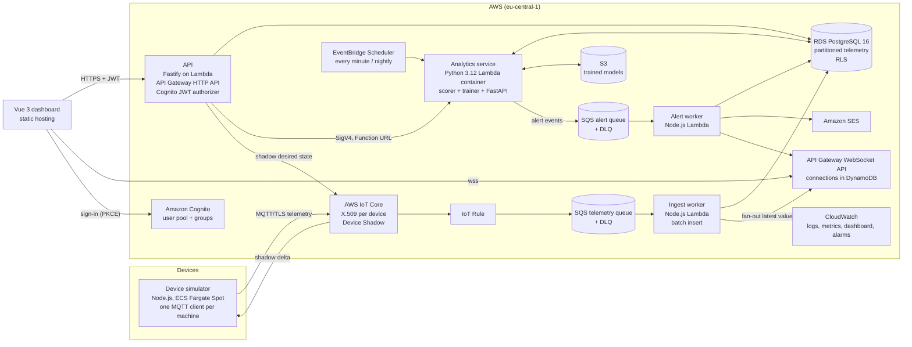

# Kinetiq: production build plan

Status: plan, not started. Written 3 October 2026.
Owner: Alexandru Lungu. Intended reader: the coding agent (Claude Code or Codex) working in this repository, and me.

This document turns Kinetiq from a frontend-only demo into a complete, production-grade system: real devices (simulated) talking MQTT to AWS, a Node.js/TypeScript backend, a Python analytics service, PostgreSQL, authentication with roles, live updates, alerting, infrastructure as code, CI/CD, observability and a measured load test. Read all of it before writing code. Work phase by phase; each phase ends deployed, tested and documented.

---

## 0. Why this project, and what it must prove

All six of my production systems run on Supabase or Firebase. The roles I am applying for (full-stack, product engineering, consulting delivery) keep asking for **Node.js, AWS, a custom API, PostgreSQL and often Python**. Kinetiq is the right place to show that, because industrial condition monitoring is a genuinely backend-heavy domain: device ingestion, time-series storage, analytics, alerting, commands back to equipment and live dashboards.

After this project I must be able to say, truthfully and with links:

1. I designed and built an event-driven backend on AWS without a backend-as-a-service: MQTT device ingestion, queues, workers, an API, a relational database and scheduled jobs.
2. I wrote a Python service that does real analytics (anomaly detection and health scoring) and measured how well it works.
3. Everything is created from code (AWS CDK in TypeScript), deployed by CI with no stored cloud keys, monitored, alarmed and cost-capped.
4. Authorization is enforced on the server and in the database, with roles and multi-tenancy.
5. The numbers in the README (latency, throughput, detection quality, monthly cost) were measured, not estimated.

### Non-goals

- No LLM or generative-AI features. This project is about backend, data and infrastructure. Classic machine learning only.
- No React rewrite. The Vue 3 frontend stays; it becomes a real client of the API.
- No client code or data from the 2023 commercial project. Everything stays fictional. Keep the README's background section and its disclaimer.
- No "production" claims that are not true. This is a reference system with simulated devices, run at small scale. The README says exactly that, and has a "What production would still need" section.

---

## 1. Target architecture



### Data flow in one paragraph

Each simulated machine is an MQTT client with its own X.509 certificate. Every 10 seconds it publishes a reading (temperature, vibration, spindle speed, power, operating state) to `kinetiq/{site}/{machine}/telemetry`. An IoT Rule forwards messages to an SQS queue. A Node.js Lambda consumes batches, validates them, inserts them into a partitioned PostgreSQL table and pushes the latest values to connected browsers over a WebSocket. Every minute, a Python Lambda scores each machine's recent window for anomalies and writes a health record; nightly, it retrains a per-machine model and stores it in S3. When a score crosses the machine's thresholds, the Python service emits an alert event; a Node.js worker records it, emails subscribed users and pushes it to the dashboard. Operators sign in with Cognito, read data through a Fastify API and send commands (maintenance mode, monitoring on/off) that the API writes to the machine's Device Shadow; the simulator applies the change and reports it back, and the UI shows the command moving from "pending" to "applied".

### Why each choice (keep these in the README's decisions section)

| Decision | Choice | Why | Alternative rejected |
|---|---|---|---|
| Device protocol | MQTT over TLS to AWS IoT Core | It is what the original product used and what industrial equipment speaks; IoT Core gives per-device certificates, policies and Device Shadow | HTTP POST from devices: not how equipment works |
| Buffer between devices and DB | IoT Rule → SQS → Lambda | Back-pressure, retries, a dead-letter queue and batch inserts; the DB never takes one insert per message | IoT Rule straight into Lambda per message: no batching, no buffer |
| Database | RDS PostgreSQL 16, `db.t4g.micro`, single-AZ, native partitioning + `pg_partman` + `pg_cron` | Postgres is what job ads ask for; partitioning and retention are real time-series techniques; cheapest always-on option | Timestream (closed to new customers), DynamoDB (not relational, not what I am showing), Aurora Serverless v2 (the simulator keeps it awake, so it costs more than a micro instance) |
| API | Fastify + TypeScript, deployed to Lambda behind API Gateway HTTP API | Scales to zero, no load balancer to pay for, Cognito JWT checked by API Gateway before code runs. The same Fastify app runs as a normal server locally and ships a Dockerfile, so it is portable to ECS | ECS Fargate + ALB: the ALB alone is ~$16-20/month idle |
| Live updates | API Gateway WebSocket API, connection IDs in DynamoDB with TTL | Managed, cheap at this scale, standard pattern | Polling only: fine fallback, kept for when the socket drops |
| Analytics | Python 3.12 Lambda container image (numpy, pandas, scikit-learn) | Right language for time-series analysis and ML; container image because scikit-learn exceeds the zip limit | Doing analytics in Node: wrong tool, and Python is the skill to show |
| Auth | Cognito user pool, groups `operator`, `engineer`, `admin`; managed login with PKCE | Standard on AWS, JWT verified at the gateway | Rolling my own auth |
| Infrastructure | AWS CDK v2 in TypeScript, `cdk-nag` | Infrastructure as code in the same language as the backend; nag rules catch insecure defaults | Console clicking; Terraform (fine, but CDK keeps one language) |
| Egress from private subnets | `fck-nat` on a `t4g.nano` instance (~$3-4/month) | Lambdas in the VPC need outbound access; a managed NAT Gateway is ~$32/month idle. Documented as non-HA | NAT Gateway (cost), VPC interface endpoints for everything (~$7/month each) |
| CI auth to AWS | GitHub Actions OIDC → IAM role | No stored keys, mirrors the existing Workload Identity Federation for Firebase | Access keys in GitHub secrets |
| Region | `eu-central-1` (Frankfurt) | EU data residency; fits the German-manufacturer background | - |

Verify every price and service availability with the AWS Pricing Calculator and current AWS docs before building. Prices and product availability change; the numbers here are planning estimates.

---

## 2. Repository layout after the change

Convert the repository into an npm workspaces monorepo, plus one Python project managed with `uv`.

```
kinetiq/
  apps/
    web/                     # the existing Vue 3 app, moved here unchanged first
  services/
    api/                     # Fastify API (TypeScript)
    ingest/                  # SQS → Postgres worker (TypeScript Lambda)
    alerts/                  # alert worker (TypeScript Lambda)
    realtime/                # WebSocket connect/disconnect/fan-out handlers (TypeScript Lambda)
    simulator/               # device simulator (TypeScript, Fargate task + local CLI)
    analytics/               # Python: scorer, trainer, FastAPI internal API
  packages/
    contracts/               # Zod schemas → OpenAPI → generated TS types; telemetry message schema
    db/                      # Drizzle schema, SQL migrations, seed, test helpers
    config/                  # shared tsconfig, eslint, vitest presets
  infra/                     # AWS CDK app (TypeScript) + tests
  load/                      # k6 scripts and saved results
  docs/
    PRODUCTION_PLAN.md       # this file
    ARCHITECTURE.md          # final architecture, written at the end of Phase 1 and kept current
    RUNBOOK.md               # alarms, what they mean, what to do
    COSTS.md                 # measured monthly cost, from Cost Explorer
    DEPLOYMENT.md            # updated for the new pipeline
    VERIFICATION.md
  docker-compose.yml         # local Postgres + Mosquitto MQTT broker
  .github/workflows/         # verify, deploy-web, deploy-infra
```

Moving the web app to `apps/web` is the first commit of Phase 0, done on its own, with `firebase.json`, the workflow and all existing tests updated so nothing else changes. All existing tests must keep passing at every step.

---

## 3. Data model (PostgreSQL)

Write migrations as SQL (Drizzle Kit generates the base; partitioning, RLS, functions and extensions are hand-written SQL in the same migration folder). Every table has `created_at timestamptz default now()`.

### Tenancy and identity

| Table | Columns (main) | Notes |
|---|---|---|
| `organizations` | `id uuid pk`, `name` | The demo has one organization; the model supports many |
| `sites` | `id`, `organization_id`, `name`, `timezone` | e.g. "Werk Nord", fictional |
| `app_users` | `id`, `cognito_sub unique`, `organization_id`, `email`, `display_name`, `role` (`operator`/`engineer`/`admin`) | Role mirrors the Cognito group; the API reads the group from the JWT and the org from this table |
| `audit_log` | `id`, `organization_id`, `user_id`, `action`, `entity`, `entity_id`, `payload jsonb`, `at` | Every write through the API appends here |

### Machines and devices

| Table | Columns | Notes |
|---|---|---|
| `machines` | `id text pk` (e.g. `mill-01`), `organization_id`, `site_id`, `name`, `kind` (matches `MachineKind`), `location`, `hidden bool` | Same ids as the current simulator, so the UI's fixtures still make sense |
| `devices` | `thing_name pk`, `machine_id unique`, `certificate_id`, `last_seen_at` | One IoT thing per machine |
| `machine_settings` | `machine_id pk`, `state_names text[8]`, `watch_below`, `warning_below`, `critical_below`, `updated_by`, `updated_at` | Replaces the browser-only settings |
| `model_settings` | `machine_id pk`, `method` (`zscore`/`isolation_forest`), `window_minutes`, `zscore_threshold`, `contamination`, `min_confidence`, `updated_by`, `updated_at` | The "model hyperparameters" operators tuned in the original product. Engineers and admins only |
| `machine_modes` | `machine_id pk`, `maintenance_mode`, `monitoring_enabled`, `desired_version`, `reported_version`, `updated_at` | Mirrors the Device Shadow; the UI shows pending while desired ≠ reported |

### Telemetry and derived data

| Table | Columns | Notes |
|---|---|---|
| `telemetry` | `machine_id`, `ts timestamptz`, `temperature_c real`, `vibration_mm_s real`, `spindle_rpm real`, `power_kw real`, `state_index smallint`, `online bool`, `received_at` | **Partitioned by range on `ts`, daily partitions** via `pg_partman`; primary key `(machine_id, ts)`; retention 30 days raw via `pg_partman` + `pg_cron`. Inserts are idempotent (`on conflict do nothing`) because SQS is at-least-once |
| `telemetry_hourly` | `machine_id`, `hour`, avg/min/max per metric, `samples`, `online_share`, `state_share real[8]` | Rollup kept for a year; maintained by a `pg_cron` job every 5 minutes for the open hour and once for the closed hour |
| `machine_health` | `machine_id`, `ts`, `method`, `anomaly_score real` (0-100), `health_score real` (0-100), `confidence real` (0-1), `contributors jsonb` (per-feature contribution), `model_version` | Written by the Python scorer every minute. Partitioned monthly |
| `predictions` | `machine_id`, `computed_at`, `metric`, `threshold`, `eta timestamptz null`, `slope`, `r2` | Time-to-threshold forecast for "next maintenance" |
| `alerts` | `id`, `machine_id`, `level` (0-3, matches `AlertLevel`), `kind` (`availability`/`anomaly`/`offline`/`forecast`), `message_key`, `value`, `snapshot jsonb`, `opened_at`, `resolved_at`, `dedupe_key unique` | `dedupe_key` stops repeated alerts for the same open condition |
| `alert_dismissals` | `alert_id`, `user_id`, `at` | Dismissal is per user, as in the current UI |
| `maintenance_entries` | `id`, `machine_id`, `category` (matches `FaultCategory`), `at`, `note`, `created_by` | Replaces the local "add fault data" action |
| `fault_events` | `id`, `machine_id`, `category`, `started_at`, `ended_at`, `source` (`simulator_injected`/`operator`) | Ground truth for the analytics evaluation |

### Security inside the database

- Row Level Security on every tenant table, keyed on `current_setting('app.organization_id')`. The API sets it with `set local` at the start of every transaction from the authenticated user's organization. The API also filters by organization in every query; RLS is defense in depth, and a test proves a query without the setting returns nothing.
- Three database roles: `kinetiq_api` (read/write tenant data, RLS enforced), `kinetiq_ingest` (insert into `telemetry`, update `devices.last_seen_at`, nothing else), `kinetiq_analytics` (read telemetry and settings, write `machine_health`, `predictions`, read/write `fault_events` for evaluation). No service uses the master user at runtime.
- Credentials: IAM database authentication for the Lambdas (short-lived tokens, no passwords in code), master credentials only in Secrets Manager, used by the migration job.

---

## 4. Contracts

### MQTT

- Telemetry topic: `kinetiq/{siteId}/{machineId}/telemetry`, QoS 1.
- Payload (validated by Zod in `packages/contracts` and by Pydantic in analytics; one JSON Schema generated from the Zod schema is the source of truth for both):

```json
{
  "v": 1,
  "machineId": "mill-01",
  "ts": "2026-10-03T12:00:00.000Z",
  "seq": 18234,
  "online": true,
  "state": 3,
  "metrics": { "temperatureC": 61.2, "vibrationMmS": 2.41, "spindleRpm": 11850, "powerKw": 7.9 }
}
```

- Device Shadow (named shadow `modes`): desired `{ maintenanceMode, monitoringEnabled, version }`, reported the same. The simulator subscribes to the shadow delta, applies the change, reports back.
- IoT policy: each certificate may connect only as its own thing name and publish/subscribe only under its own topic prefix and shadow (`${iot:Connection.Thing.ThingName}` policy variables). A test in `infra` asserts the policy contains no wildcard publish.

### HTTP API (Fastify, OpenAPI generated from Zod with `fastify-type-provider-zod`)

All routes under `/v1`, all require a Cognito JWT (checked by API Gateway), all scoped to the caller's organization.

| Method and path | Role | Purpose | Maps to current `TelemetrySource` method |
|---|---|---|---|
| `GET /machines` | any | Roster | `listMachines` |
| `GET /machines/status` | any | Rolled-up status per machine (availability over 24 h, alert level, online) | `listStatuses` |
| `GET /machines/:id/telemetry` | any | Everything the detail view renders | `getTelemetry` |
| `GET /machines/:id/series?metric=&from=&to=&bucket=` | any | Chart data from raw or hourly table, chosen by range | new |
| `GET /machines/:id/health?from=&to=` | any | Health and anomaly history, with contributors | new |
| `GET /machines/:id/alerts` | any | Alerts / notifications | `listNotifications` |
| `POST /alerts/:id/dismiss` | any | Per-user dismissal | `dismissNotification` |
| `PATCH /machines/:id/hidden` | admin | Hide/restore from roster | `removeMachine` / `restoreAllMachines` |
| `PUT /machines/:id/modes` | operator+ | Maintenance mode / monitoring; writes the Device Shadow; returns 202 with the desired version | `setMaintenanceMode` / `setMonitoringEnabled` |
| `GET /machines/:id/settings`, `PUT /machines/:id/settings` | read any, write engineer+ | State names, thresholds | `getSettings` / `saveSettings` |
| `GET /machines/:id/model`, `PUT /machines/:id/model` | read any, write engineer+ | Analytics settings; PUT triggers a recompute via the analytics service | new |
| `GET /machines/:id/maintenance`, `POST /machines/:id/maintenance` | read any, write operator+ | Maintenance entries | `listMaintenanceEntries` / `addMaintenanceEntry` |
| `GET /me` | any | Profile, role, organization | new |
| `GET /healthz` | none (public) | Liveness: app up, DB reachable | new |

Conventions: RFC 9457 problem+json errors; cursor pagination on lists; `ETag` + `If-None-Match` on status and telemetry reads; idempotency key header on POSTs; request ID in every log line and response header; rate limit per user (API Gateway throttling plus a per-user token bucket in the app for writes).

### Analytics internal API (FastAPI, Lambda Function URL with `AWS_IAM` auth, called only by the API with SigV4)

| Route | Purpose |
|---|---|
| `POST /recompute/{machine_id}` | Re-score the last window immediately after model settings change |
| `GET /explain/{machine_id}?at=` | Per-feature contributions for one score (feeds the "why flagged" panel) |
| `POST /backtest` | Run the evaluation on stored data with given settings; returns precision, recall, detection delay |

---

## 5. The Python analytics service (what it does and why)

This is the part that replaces the fake `anomalyScore`, `confidence` and predicted maintenance windows in today's simulator with real computations. It mirrors the original product, which had a machine-learning model whose hyperparameters operators tuned from the dashboard.

### Package layout (`services/analytics`)

```
analytics/
  pyproject.toml              # uv; Python 3.12; ruff; mypy --strict; pytest
  src/kinetiq_analytics/
    features.py               # windowing, rolling stats, resampling (pandas/numpy)
    detectors/
      zscore.py               # rolling robust z-score (median/MAD), per metric
      isolation_forest.py     # scikit-learn IsolationForest on window features
    health.py                 # anomaly score → health score + confidence; contributors
    forecast.py               # linear trend on vibration/temperature → time to threshold
    alerts.py                 # threshold logic + dedupe keys; emits events to SQS
    evaluation.py             # backtest against fault_events ground truth
    db.py                     # SQLAlchemy 2.0 Core + psycopg 3; IAM auth token
    models_store.py           # joblib models in S3, versioned
    handlers/
      score.py                # Lambda: every minute, all machines
      train.py                # Lambda: nightly, per machine
      api.py                  # FastAPI app, served on Lambda via Mangum
  tests/                      # pytest; Testcontainers Postgres; hypothesis for features
  Dockerfile                  # public.ecr.aws/lambda/python:3.12 arm64 base
```

### Algorithms, kept simple and explainable

1. **Features per window** (default 30 minutes, configurable): mean, std, max, slope and spectral-free RMS for vibration; mean and slope for temperature; power per rpm; share of time in each operating state; online share.
2. **Detector A, robust z-score**: per metric, `(x - median) / (1.4826 * MAD)` against the machine's last 7 days at the same operating state. Score is the max absolute z, mapped to 0-100. Contributors are the per-metric z values.
3. **Detector B, IsolationForest**: trained nightly per machine on the last 7 days of window features, excluding windows overlapping known `fault_events`. Score from `decision_function`, calibrated to 0-100 with the training distribution's percentiles. Contributors from per-feature deviation of the scored window versus training medians (simple and honest; do not claim SHAP).
4. **Health score**: `100 - anomaly_score`, smoothed with an exponential moving average so one noisy minute does not flip the dashboard.
5. **Confidence**: from sample count in the window and model age (fewer samples or an old model lowers it). Below `min_confidence`, the machine shows "insufficient data" instead of a score.
6. **Forecast**: ordinary least squares on hourly vibration RMS over 72 hours; if the slope is positive and the fit is reasonable (R² ≥ 0.5), compute when it crosses the warning level. This becomes the "next maintenance" window the UI already displays.
7. **Alerts**: open an alert when health falls below the machine's thresholds for N consecutive minutes; resolve when it recovers; dedupe on `(machine, kind, level)`.

### Measured evaluation (required, and the numbers go in the README)

The simulator injects labelled faults (Section 6) and writes them to `fault_events`. `evaluation.py` replays a fixed 14-day simulated dataset (seeded, committed as a compressed fixture) through both detectors and reports:

| Metric | Meaning |
|---|---|
| Precision / recall per fault type | Did we flag real faults, and only those? |
| Median detection delay | Minutes from fault start to first alert |
| False alerts per machine per day | The number operators actually care about |

Run it with `uv run kinetiq-eval`. It is deterministic and runs in CI on the fixture (fast, no AWS). Report both detectors honestly, including where z-score beats IsolationForest if it does. That comparison is the interview story.

### Quality gates (same standard as the TypeScript side)

`ruff check`, `ruff format --check`, `mypy --strict`, `pytest` with coverage on `features`, `detectors`, `health`, `forecast`, `alerts` (target 90% on those modules), Testcontainers integration test for the scorer end to end against Postgres, and a contract test that the FastAPI OpenAPI matches what the Node API client expects.

---

## 6. Device simulator (`services/simulator`)

- Reuses the ideas of today's `simulator.ts` (stable per-machine profiles, deliberate mix of healthy, warning, critical, offline) but produces **raw sensor readings**, not finished UI values. All derived values now come from the backend.
- 12 machines by default (the current roster). Configurable count for load tests (up to 500).
- Physics-flavoured signals: temperature follows load with lag; vibration has a baseline per machine plus noise; operating states change on a schedule.
- **Fault injection** with ground truth: bearing wear (slow vibration drift over hours), overheating (temperature ramp), electrical spikes (short power bursts), sensor dropout (missing data), and going offline. Each injected fault is logged to `fault_events` through an admin-only API route, so analytics can be evaluated.
- Runs in two modes: `--target local` publishes to Mosquitto from `docker-compose.yml`; `--target aws` connects to IoT Core with per-device certificates (loaded from Secrets Manager in Fargate, from a git-ignored folder locally).
- Applies Device Shadow deltas (maintenance mode stops fault injection and changes the operating state; monitoring off stops publishing metrics but keeps the heartbeat).
- In AWS it runs as one ECS Fargate Spot task (0.25 vCPU, 0.5 GB, arm64, public subnet with public IP and no inbound rules). If the task is interrupted, ECS restarts it; the gap is visible as "offline", which is realistic.

---

## 7. Frontend changes (`apps/web`)

1. **Make the data seam asynchronous.** `TelemetrySource` is synchronous today. Change every method to return a `Promise`, update the stores to track `loading`/`error` per request, and keep `LocalTelemetrySource` working (wrap its results in resolved promises). Existing tests must keep passing before any HTTP code is added.
2. **Add `HttpTelemetrySource`** using generated types from `packages/contracts`. Select the source with `VITE_DATA_SOURCE=local|http`. Local stays the default for development and component tests.
3. **Auth**: Cognito managed login with authorization code + PKCE (`oidc-client-ts`). Tokens in memory, refresh token handled by the library; no tokens in `localStorage`.
4. **Demo access for recruiters**: the sign-in page has two buttons, "Enter as operator" and "Enter as maintenance engineer", using two published demo accounts. Their writes are rate-limited and everything they change is reset nightly by a scheduled job. Show which role you are and what it can do.
5. **New UI**: health and anomaly history chart (inline SVG, same approach as today, no chart library), a "why flagged" panel showing contributors, model settings form for engineers, command state "pending / applied / failed" for mode toggles, connection indicator for the live socket with polling fallback.
6. **Content Security Policy**: add the API, WebSocket and Cognito domains to `connect-src` and nothing else.
7. Keep the accessibility guarantees and their tests (focus handling, roles, shapes not just colours) for every new component.
8. **Playwright end-to-end** against the deployed environment: sign in as each demo role, see live data change, toggle maintenance mode and watch it apply, change a model setting as engineer, confirm operator cannot.

Hosting: keep the static frontend on Firebase Hosting during Phases 0-4 so `kinetiq-dashboard.web.app` (linked from my CV, site and LinkedIn) keeps working. Phase 5 optionally moves it to S3 + CloudFront and turns the Firebase site into a redirect. That is my decision to make; do not do it without asking.

---

## 8. Infrastructure (AWS CDK, `infra/`)

Stacks, deployed in this order:

| Stack | Contents |
|---|---|
| `BudgetStack` | AWS Budgets: $20/month with alerts at 50%, 80%, 100% to my email; created first, before anything that costs money |
| `NetworkStack` | VPC across 2 AZs: public subnets, private subnets, **no NAT Gateway**; `fck-nat` instance for egress; S3 and DynamoDB gateway endpoints (free) |
| `DataStack` | RDS PostgreSQL 16 `db.t4g.micro` in private subnets, encrypted, automated backups 7 days, deletion protection on, Performance Insights free tier, parameter group with `pg_partman`, `pg_cron`, `rds.force_ssl=1`; Secrets Manager master secret; S3 bucket for models (versioned, encrypted, block public access) |
| `MigrationStack` | A migration Lambda run on every deploy through a CDK `Trigger`, using the master secret; creates roles, extensions, partitions, RLS |
| `IotStack` | Things, certificates provisioned by a custom resource, per-device policy, IoT Rule → SQS telemetry queue with DLQ (maxReceiveCount 5), rule error action to a CloudWatch log group |
| `AuthStack` | Cognito user pool (email sign-in, MFA optional, strong password policy), groups, app client with PKCE, managed login domain, demo users created by a custom resource with passwords in Secrets Manager |
| `ComputeStack` | Ingest, alerts, realtime and API Lambdas (Node.js 22 or newer runtime available at build time, arm64, Powertools for AWS Lambda), analytics Lambda container (Python 3.12, arm64), EventBridge Scheduler rules, SQS alert queue + DLQ, DynamoDB connections table, SES identity, Function URL for analytics with IAM auth |
| `ApiStack` | API Gateway HTTP API with Cognito JWT authorizer, throttling, access logs; WebSocket API with authorizer Lambda; custom domain optional |
| `SimulatorStack` | ECS cluster, Fargate Spot service (desired count 1), task role allowed to read device secrets only |
| `ObservabilityStack` | CloudWatch dashboard, alarms (below) → SNS → my email; log retention 14 days on every log group |

Rules for the CDK code:
- `cdk-nag` (AwsSolutions pack) runs in tests; every suppression has a written reason.
- Fine-grained assertions in `infra/test`: no NAT Gateway exists, RDS is not publicly accessible, every log group has retention, every queue has a DLQ, no IAM policy has `*` resource on write actions except where AWS requires it (documented).
- One environment (`prod`) plus local. A second environment is a config change, not a code change; prove it by synthesizing a `staging` stage in tests.
- Tags on everything: `project=kinetiq`, `env`, `owner`.

### Cost budget (estimate, verify before building)

| Item | Approx. monthly |
|---|---|
| RDS `db.t4g.micro` + 20 GB gp3 | $14-17 |
| `fck-nat` `t4g.nano` | $3-4 |
| Fargate Spot 0.25 vCPU / 0.5 GB arm64 | $2-4 |
| IoT Core (12 devices, 1 msg / 10 s ≈ 3.1 M msgs) + rules | $3-5 |
| Lambda, SQS, API Gateway, DynamoDB, EventBridge at demo traffic | $1-3 |
| CloudWatch logs and metrics (14-day retention) | $2-4 |
| Secrets Manager (3-4 secrets) | ~$1.5 |
| Cognito (few users), SES (few emails), S3 | ~$0-1 |
| **Total target** | **under $30, alarm at $20** |

New AWS accounts may have free-tier credits; do not rely on them in the design. Record the real cost from Cost Explorer after 30 days in `docs/COSTS.md`.

---

## 9. Security checklist (all must be true before the demo accounts are published)

- [ ] Root account has MFA and no access keys; I work through an IAM Identity Center user (I do this myself in the console).
- [ ] CI deploys through a GitHub OIDC role restricted to this repository and the `main` branch; pull requests get a read-only role for `cdk diff`.
- [ ] No secrets in the repository or in GitHub secrets except the role ARNs (not secret).
- [ ] RDS in private subnets, TLS enforced, IAM auth for services, least-privilege DB roles, RLS on tenant tables.
- [ ] Every Lambda has its own role with only the actions and resources it needs.
- [ ] IoT policies limit each device to its own topics and shadow.
- [ ] API: JWT checked at the gateway; role checked in the handler; organization enforced in query and RLS; input validated with Zod; output validated in tests; problem+json errors never leak stack traces.
- [ ] Rate limits on writes; demo accounts limited further; nightly reset.
- [ ] Dependency audit (npm and `pip-audit`) in CI, failing on high/critical.
- [ ] Security headers and CSP on the frontend checked by the existing smoke test.
- [ ] Threat model section in `docs/ARCHITECTURE.md`: spoofed devices, replayed messages, cross-tenant reads, cost abuse through the public demo.

---

## 10. Observability and operations

- **Logs**: JSON via Powertools (TypeScript and Python), with request ID, user ID (hashed), machine ID, cold start flag.
- **Tracing**: X-Ray through Powertools tracer across API → DB, ingest → DB, analytics → DB.
- **Metrics** (Embedded Metric Format): messages ingested, batch size, ingest lag (`received_at - ts`), end-to-end latency to the socket, scores computed, minutes since last successful score per machine, alerts opened, API latency by route.
- **Alarms**: telemetry DLQ > 0; alert DLQ > 0; ingest lag p95 > 60 s for 5 min; analytics staleness > 5 min; API 5xx > 1% for 5 min; any Lambda error rate > 2%; RDS CPU > 80% or free storage < 2 GB; simulator task not running; budget thresholds.
- **Dashboard**: one CloudWatch dashboard with the above, screenshot in the README.
- **Runbook**: `docs/RUNBOOK.md` lists each alarm, its likely causes and the exact steps (including how to redrive the DLQ).

---

## 11. Testing strategy

| Layer | Tool | What |
|---|---|---|
| Web unit/component | Vitest + Vue Test Utils | Everything that exists today, plus async stores, `HttpTelemetrySource` with MSW mocks, new components with accessibility assertions |
| API | Vitest + `fastify.inject` + Testcontainers Postgres | Every route: auth roles, org isolation, validation errors, idempotency, ETags, audit log entries |
| DB | Vitest + Testcontainers | Migrations from empty; RLS blocks cross-tenant reads and blocks reads with no org set; partition creation and retention; idempotent inserts |
| Ingest / alerts | Vitest + Testcontainers | Batch insert, partial batch failure reporting to SQS (`batchItemFailures`), duplicates ignored, dedupe of alerts |
| Analytics | pytest + hypothesis + Testcontainers | Feature maths, both detectors, health/confidence, forecast, alert logic, evaluation on the fixture, FastAPI routes |
| Contracts | Vitest + pytest | Zod schema and Pydantic model accept/reject the same fixture set; OpenAPI of analytics matches the client |
| Infra | CDK assertions + cdk-nag | The rules in Section 8 |
| End to end | Playwright | The journeys in Section 7, against the deployed stack, after each production deploy |
| Load | k6 | Section 12 |

CI on every push and pull request: lint, typecheck, unit and integration tests (Docker is available on GitHub-hosted Ubuntu runners), Python gates, `cdk synth` + nag + assertions, dependency audits. On pull requests, `cdk diff` posted as a comment. On `main`: deploy infra, run migrations (Trigger), deploy web, run the smoke test and Playwright journeys; a failing smoke test fails the run and is reported.

---

## 12. Load test and the numbers for the README

- Scale the simulator to 100, 250 and 500 devices at 1 msg / 10 s, then a burst at 1 msg / s for 5 minutes.
- Measure: ingest throughput sustained without DLQ growth, ingest lag p50/p95, end-to-end device-to-browser latency p95, DB CPU, Lambda concurrency, and cost of the test run.
- k6 against the API with 50 virtual users mixing status, detail and series reads: p95 latency per route, error rate.
- Save raw results in `load/results/` with the date and the exact configuration. The README quotes them with the date, the same way the portfolio site quotes figures.
- Stop the scaled test and return to 12 devices afterwards. Do not leave a load test running.

---

## 13. Phases and definition of done

Each phase is merged to `main`, deployed, verified live, and the README updated before the next starts.

### Phase 0: groundwork (no AWS spend)
- Monorepo conversion; web app moved to `apps/web`; CI updated; all existing tests green.
- `TelemetrySource` made asynchronous; stores handle loading and errors; tests green.
- `packages/contracts` with the telemetry message schema and fixtures.
- `docker-compose.yml` with Postgres 16 and Mosquitto; `packages/db` with migrations and seed.
- Simulator in local mode publishing to Mosquitto; a local ingest runner (same handler code, MQTT consumer instead of SQS) writing to local Postgres.
- **Done when** `docker compose up` + `npm run dev:all` shows the dashboard reading real rows from local Postgres through the API running locally.

### Phase 1: the backend on AWS
- I set up the AWS account, Identity Center user and budget email (manual, documented in `docs/DEPLOYMENT.md`); the agent writes the CDK.
- Budget, network, data, migration, IoT, compute (ingest only), API (read routes, Cognito), simulator stacks.
- Web uses `HttpTelemetrySource` in production; demo accounts with read access.
- **Done when** the live demo shows 12 machines with real ingested data, alarms exist, cost is tracking under budget, and `docs/ARCHITECTURE.md` describes what is deployed. Update my CV and portfolio at this point (Section 15).

### Phase 2: Python analytics
- Analytics package, both detectors, health, confidence, forecast, alerts to SQS, alert worker, nightly trainer, model storage.
- Fault injection in the simulator with ground truth; evaluation script and committed fixture; results table in the README.
- UI: health history, "why flagged" panel, model settings for engineers.
- **Done when** injected faults visibly raise alerts on the live demo and the README shows the measured precision, recall and detection delay for both detectors.

### Phase 3: control and live updates
- Device Shadow commands end to end with pending/applied/failed in the UI; audit log.
- WebSocket live updates with polling fallback.
- All write routes, role enforcement, rate limits, demo reset job.
- Playwright journeys in CI after deploy.
- **Done when** two browsers signed in as different roles see the same machine change state live, and the operator cannot do engineer-only actions (tested).

### Phase 4: production hardening and proof
- Observability dashboard, all alarms, runbook.
- Load tests and published results.
- Security checklist complete; threat model written.
- `docs/COSTS.md` with the real 30-day cost.
- README rewritten (Section 14).
- **Done when** every item in Sections 9-12 is checked and the README numbers are all measured.

### Phase 5: optional
- Move the frontend to S3 + CloudFront with the old URL redirecting (ask me first).
- Custom domain (ask me first; it costs money).
- A second organization in the demo to show tenancy visually.

---

## 14. README after the project

Keep the current tone: honest, specific, every claim checkable.

1. One-paragraph summary and the live demo with the two demo roles.
2. Architecture diagram (Section 1) and a short data-flow paragraph.
3. "Try it in two minutes" updated for the real system.
4. Engineering decisions table (Section 1), including what each choice costs.
5. Analytics: the method, the evaluation table, what it cannot detect.
6. Measured numbers: ingest throughput and latency, API p95, end-to-end latency, monthly cost, test counts per language, all dated.
7. Security model and threat model summary.
8. Operations: dashboard screenshot, alarms, runbook link.
9. Background section kept: the 2023 client project, what this repository shares (nothing), and that all data is fictional.
10. **Known limitations and what production would still need**: single-AZ database, non-HA NAT instance, single region, simulated devices, no device fleet provisioning at scale (fleet provisioning by claim), no SSO, no data export, model quality measured only on simulated faults.
11. Run locally, verify, deploy.

---

## 15. After each milestone, update my portfolio (do not skip)

These live outside this repository; list the exact text changes for me, or make them if the session has access:

- `D:\DOCS\Desktop\alexandru-lungu\src\lib\projects.ts`: the Kinetiq entry (period, role, stack, summary, ledger with measured numbers, sections). Remove "no backend" wording. Update RO/RU summaries in `src/lib/i18n.ts`. Update the home page's public test count.
- CV: the Kinetiq project lines and the skills section (Node.js API on AWS, AWS CDK, IoT Core, SQS, Lambda, RDS PostgreSQL, Cognito; Python with FastAPI, pandas, scikit-learn). Keep it two pages.
- LinkedIn: Kinetiq project text and Featured item description.
- GitHub repository description and topics.

The portfolio currently says Kinetiq has "34 tests, 4 runtime dependencies" and "no backend". Those facts will stop being true; update them in the same week the change ships.

---

## 16. Working rules for the coding agent

- Read this file, the README, `docs/DEPLOYMENT.md`, `docs/VERIFICATION.md`, `src/services/telemetryService.ts`, `src/services/simulator.ts`, `src/types/telemetry.ts` and the tests before writing code.
- Plan each phase as a list of files and commits, show it to me, then implement in small commits with clear messages explaining why.
- Run every gate (lint, types, tests in both languages, `cdk synth` + nag) before each commit.
- **Never run `cdk deploy`, create AWS resources, or spend money without my explicit confirmation in the session.** Give me the exact command and what it will create and cost.
- Never commit secrets, certificates, private keys or `.env` files. Add them to `.gitignore` first.
- Do not break the live demo. Until Phase 1 is done, production stays on the local data source.
- Do not change the existing accessibility behaviour; extend its tests to new components.
- When unsure about an AWS service limit, price or API, check the current AWS documentation instead of guessing, and tell me what you checked.
- At the end of each phase, give me: what was built, test counts per package, measured numbers, current AWS cost, and anything you were unsure about.

---

## 17. Decisions I still need to make

| Decision | Default if I do not answer |
|---|---|
| AWS account: new or existing | New account dedicated to Kinetiq |
| Region | `eu-central-1` |
| Budget alarm | $20/month |
| NestJS instead of Fastify | Fastify |
| Move frontend to CloudFront in Phase 5 | No |
| Custom domain | No |
| Email sender for alerts (SES needs a verified identity) | My own address, verified, sandbox mode, emails only to demo-subscribed addresses |
