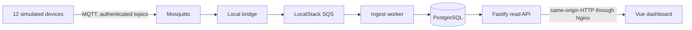

# Phase 0: connecting stored readings to the dashboard

This lesson continues [the messaging lesson](PHASE_0_MESSAGING.md). The previous
checkpoint moved fictional sensor readings into PostgreSQL. This checkpoint
lets the browser read those stored values and starts the whole system together.
All examples refer to our own portfolio project and local development data.

## Follow one reading



The sensor values remain simulated, but their journey uses actual containers,
broker connections, queue deliveries, SQL transactions and HTTP requests.
The dashboard's temperature now comes from a database row. Refreshing the page
does not generate a replacement temperature in the browser.

## 1. An API turns a browser request into a controlled database read

The browser cannot use PostgreSQL's protocol, and giving it database credentials
would give every visitor those credentials. Instead it requests a resource:

```http
GET /v1/machines/DEMO-CNC-01/telemetry
```

`services/api/src/index.ts` declares that route. Fastify matches the URL, validates
its parameters, calls the read model, validates the response and serializes JSON.
`read-model.ts` contains the SQL and the mapping from database columns to API
fields. `main.ts` handles process configuration, listening and shutdown.

We use dependency injection: `buildApi()` receives a pool and a clock. Integration
tests can create real isolated databases and freeze time without opening a public
server or rewriting the application's logic.

The implemented `/v1` resources include machines, statuses, latest telemetry,
settings, maintenance history, alerts, model settings, minute/hour sensor series
and health history. Series queries require explicit dates and a known metric;
minute queries span at most 24 hours and hourly queries at most 60 days. Results
are capped. A misspelled metric cannot become an arbitrary SQL column.

## 2. Tenant isolation survives connection reuse

The local API has an explicit `local-readonly` mode and one server-configured
fictional organization. Request headers and query strings cannot select a tenant.
Cognito authentication and authorized writes remain planned work. This local
identity is not a substitute for cloud authentication.

Each read follows this sequence on one checked-out connection:

```sql
BEGIN;
SELECT set_config('app.organization_id', '<trusted organization UUID>', true);
SET TRANSACTION READ ONLY;
-- Read application tables; their row-level security policies apply.
COMMIT;
```

The final `true` makes the setting transaction-local. When the connection returns
to the pool, the next request does not inherit this tenant. Without a tenant,
row-level security returns no tenant rows. The API uses `kinetiq_api`, with a
maximum of five connections and no migration or administrator privileges.

Hidden, absent and other-tenant machines return the same 404 response. Database
outages produce a controlled 503 problem response rather than exposing SQL or
connection strings. Every request receives a server-generated request ID.

## 3. Contracts have both compile-time and runtime checks

TypeScript checks our own source before execution. JSON arriving over HTTP is
still untrusted data: an outdated server or broken proxy can return something
unexpected. `packages/contracts/src/api.ts` defines Zod request/response schemas.
Both Fastify and the HTTP adapter validate against them.

The API also generates an OpenAPI document and TypeScript client types. The
dashboard's machine-list signature consumes those generated types. Normal API
builds check that committed artifacts match the routes; they do not silently
rewrite the contract. For an intentional contract change run:

```sh
npm run schema:update --workspace @kinetiq/api
npm run build --workspace @kinetiq/contracts
```

Review `packages/contracts/schema/api.openapi.json` and
`packages/contracts/src/generated/api.ts` with the route change.

## 4. Missing data stays missing

An anomaly score requires a scorer. A prediction requires a prediction process.
Neither exists yet, so the API returns `null`; the UI displays an unavailable
value. No samples means unknown availability, not a perfect score or a failure.

Current availability is the percentage of received samples whose `online` flag
was true during the last 24 hours. It does not establish uptime during reporting
gaps. Fleet availability averages machines with observations. A machine is
currently online only when its latest reading says online and is at most two
minutes old. The sidebar explains the backend data path; dashboard conditions
are labelled separately from persisted alert records.

The HTTP adapter reports network/schema errors. It does not switch to the browser
simulator after an outage. Its mutation methods refuse writes. Stores and UI
controls also enforce read-only mode; the API independently rejects writes with
405 even if someone bypasses the disabled controls.

## 5. Hourly rollups make longer history affordable

Raw rows remain daily-partitioned with 30-day retention. The new additive SQL
migration creates a maintenance function that computes hourly averages, minimums,
maximums, sample counts, online share and eight state shares.

Every five minutes it refreshes the latest two hours. A daily sweep revisits the
retained 30-day window to include late deliveries. Repeating a refresh overwrites
the same aggregate key; it does not add the sample count twice. Runtime roles
cannot execute this maintenance function. The existing hourly retention job
retains rollups for one year. A newly started demo has no year of history.

## 6. Compose starts services in dependency order

`compose.yaml` declares the local system:

1. A short-lived setup container generates random passwords into Docker volumes.
   Existing passwords are preserved on restart. No password is committed.
2. PostgreSQL and authenticated Mosquitto start; LocalStack receives the token
   from the ignored root `.env.local`, outside the frontend and image context.
3. A bootstrap job applies checksum-verified migrations, seeds twelve registered
   devices, enables the two limited database logins and creates SQS/DLQ resources.
4. Ingest, bridge and API start after bootstrap succeeds. The simulator starts
   after its transport dependencies are healthy. Web starts after the API is ready.

Administrator credentials are mounted only into database/setup containers.
API and ingest get separate credential volumes; bridge and simulated devices
also receive separate MQTT credential volumes. `_FILE` environment settings tell
Node processes which mounted file to read. The API, workers and web server run
as non-root users. The brief credential setup job requires root to set volume
ownership; broker startup hashes passwords before dropping privileges.

Only web port 3101 and the local emulator inspection port 4566 bind to loopback.
The API and PostgreSQL have no published host ports. Nginx serves built frontend
assets, forwards `/v1` to the API and handles Vue deep links. This same-origin path
avoids separate browser origins and cross-origin configuration.

Long-running containers have memory caps totaling 2,432 MiB (about 2.4 GiB). This is a configured
local ceiling, not measured consumption or a Kubernetes capacity prediction.
The setup jobs have separate caps and finish before steady operation.

PostgreSQL and broker state live in named volumes. `docker compose down` stops
containers and preserves those volumes. LocalStack queues are recreated by
bootstrap after emulator replacement; local emulation is not a cloud durability
or backup guarantee. Never add `-v` when preserving local data matters.

## Run and inspect it

From the repository root, with Docker running and the developer token in
`.env.local` as `LOCALSTACK_AUTH_TOKEN=...`:

```sh
npm run local:up
npm run local:verify
docker compose ps
```

Open http://127.0.0.1:3101. Inspect a machine's latest sensor reading, timestamp
and sample count. Analytics should remain unavailable. Settings should be visible
but disabled. For the original browser-only demo, `npm run dev` still uses port
3100 and the local adapter.

Inspect stored rows without printing passwords:

```sh
docker compose exec postgres psql -U postgres -d kinetiq -c "SELECT machine_id, count(*), max(ts) FROM kinetiq.telemetry GROUP BY machine_id ORDER BY machine_id;"
```

`npm run local:verify` compares API sensor values with their exact PostgreSQL rows
for every device. Each latest reading must be at most two minutes old, so old
rows cannot hide a stopped transport. It also checks deep links and refused writes. CI adds the same
Compose gate on trusted main pushes, using `LOCALSTACK_AUTH_TOKEN_CI`. It creates
an ephemeral ignored env file for that runner; no token enters the frontend build.

## Restarting the same container

A fresh container and a restarted container are different tests. The broker's
startup script creates `/tmp/passwords` and `/tmp/acl`, then gives the Mosquitto
user ownership and mode `600` (only that owner can read and write). On a restart,
those generated files can still exist. The root startup process then tried to
overwrite a broker-owned password file in `/tmp`, and failed with "File exists".
The broker stayed down, so the simulator and bridge also lost their MQTT server.
Recreating the container hid the problem by giving it a fresh filesystem.

The script now removes only those two derived files before regenerating them
from the mounted secrets. `umask 077` restricts new files from creation, before
the final ownership/mode adjustment. Broker persistence in `/mosquitto/data`
and the secret volumes are untouched. Missing secrets still fail startup; we
do not fall back to anonymous connections or default credentials.

LocalStack is a separate recovery case: our local queue emulator loses its
queues when its process restarts. Bootstrap recreates them, but Compose may
reject workers that are already marked unhealthy before waiting for their
recovery. After a Docker-engine restart, run `docker compose up -d bootstrap`,
wait for that setup job to finish successfully, restart `ingest` and
`local-bridge`, then run `docker compose up -d --wait` and the acceptance check.
This is a local-emulator limitation; a real SQS queue survives an application
restart. PostgreSQL rows and broker persistence remain in their named volumes.

`broker-restart.test.ts` uses the actual script and configuration, writes a
retained MQTT message, gracefully restarts the same container twice, then checks
authenticated delivery and file permissions. A retained message is stored by
the broker and sent to a new subscriber; it gives us observable persistence
evidence across a graceful restart. This does not prove recovery from sudden
power loss or replace the planned database backup/restore drill.

Try `docker compose restart mosquitto`, then `docker compose ps` and
`npm run local:verify`. The bridge should reconnect; allow the simulator its
normal publishing interval. Why would `down` followed by `up` miss a bug that
`restart` catches? Which files can we recreate, and which must we preserve?

## Explain it back

- Why can a TypeScript-valid client still receive invalid JSON?
- What would happen if tenant context were session-local on a pooled connection?
- Why does absent analytics return `null` rather than zero?
- What does our sample availability measure, and what does it leave unknown?
- Why must a refresh of an hourly aggregate replace counts rather than increment them?
- Which data survives `docker compose down`, and which bootstrap resources are recreated?

The next phase remains the full Kubernetes infrastructure planned in
`PRODUCTION_PLAN.md`: k3d/k3s, charts and operators, AWS infrastructure definitions
and their checks. This checkpoint completes the local application foundation;
cloud identity, backup restoration, analytics and load evidence still require
their own implementations and verification.
