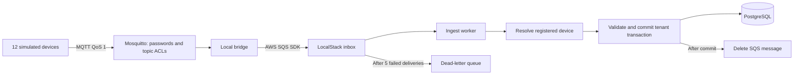

# Phase 0 lesson: from a device message to a committed database row

This checkpoint implements and tests the local transport. The dashboard still reads its browser simulator. Connecting the read API and the frontend is the next checkpoint; the full plan remains in place.

## 1. What we built



The simulator is a program pretending to be industrial devices. Mosquitto is a real MQTT broker. LocalStack imitates AWS SQS on your laptop. PostgreSQL is a real database. We use the normal AWS SDK against LocalStack, with dummy AWS credentials and an explicit local endpoint. The LocalStack account token licenses the emulator; it is separate from those dummy credentials.

The local bridge stands in for the future AWS IoT Rule. It is not a replacement for IoT Core in production. This test needs no real AWS resources and creates no AWS bill.

| Code | Responsibility |
|---|---|
| `packages/contracts/src/fleet.ts` | Shared identities for simulation and development seed |
| `services/simulator/src/index.ts` | Deterministic raw readings and per-device rate cap |
| `services/simulator/src/main.ts` | MQTT connections and publishing loop |
| `services/local-bridge/src/index.ts` | Validate topic, enqueue, then acknowledge MQTT delivery |
| `services/ingest/src/index.ts` | Poll SQS, validate, persist, acknowledge; retry failures |
| `packages/db/src/index.ts` | Registered identity lookup and tenant transaction |
| `packages/db/migrations/0002_device_identity.sql` | Restricted device registry lookup |
| `packages/runtime/src/index.ts` | Local endpoint guards, queues, logs, shutdown and health |
| `packages/pipeline-tests/tests/pipeline.test.ts` | Real broker, emulator and database integration tests |

## 2. Why use a queue?

Imagine PostgreSQL temporarily stops responding. Without a queue, the publisher and database must both be available at exactly the same time. With a queue, transport accepts the batch and the worker can try the database again later.

The worker **receives** a message first. Receipt does not remove it. SQS hides it for a visibility timeout, giving the worker a lease to process it. Our lease is 90 seconds. During processing, the worker asks for another 90 seconds every 30 seconds. If processing fails, it leaves the message alone. When the lease ends, it can be received again.

Deleting is the acknowledgement that processing succeeded. Our order is:

1. Validate the message size and schema.
2. Compare payload identity with the queue attributes.
3. Resolve the registered device, machine and site to an organization.
4. Commit telemetry using that organization inside a tenant transaction.
5. Delete the queue message.

Deleting before commit could permanently lose a batch when the database fails. Deleting after commit creates a different possibility: the commit succeeds, then the delete request fails. SQS delivers the same body again. That is why the database's `(machine_id, ts)` unique key and `ON CONFLICT DO NOTHING` are part of correctness, not optional polish.

We provide at-least-once delivery with idempotent database effects. We do not claim exactly-once transport. AWS also documents that duplicate delivery remains possible during the visibility window: [SQS visibility timeout](https://docs.aws.amazon.com/AWSSimpleQueueService/latest/SQSDeveloperGuide/sqs-visibility-timeout.html).

## 3. There are two acknowledgement boundaries

The bridge also follows an ordering rule: SQS accepts the batch **before** the bridge acknowledges its MQTT delivery. MQTT.js calls `handleMessage` before sending the subscriber's QoS 1 acknowledgement. We install that hook before connecting, so an existing subscription cannot deliver backlog before the hook exists.

If the SQS send fails, the bridge does not acknowledge successful processing. It reconnects with the same client ID and durable session. The broker then redelivers the unacknowledged message. The integration test injects precisely this failure and verifies the row eventually reaches PostgreSQL.

A publisher's QoS 1 acknowledgement means the broker accepted its message. It does not mean PostgreSQL has committed it. Each stage has its own responsibility.

## 4. Identity comes from authentication and registration

Each local device authenticates with its username and password. The broker's ACL allows that username to publish only `kinetiq/<site>/<its-machine-id>/telemetry`. A device cannot publish another device's topic. The bridge account can read telemetry topics but cannot publish them.

The bridge turns the topic into SQS attributes: `thingName`, `machineId`, `siteId`. Ingest checks the body agrees with this envelope. Then `resolveDevice` checks all three against the registry and returns the organization. A JSON field supplied by a device cannot choose the tenant.

The database lookup is a narrowly scoped `SECURITY DEFINER` function. It exposes only an exact registered mapping to the ingest role, fixes its search path, and removes public execution. Its owner is a separate `NOLOGIN` role with access only to registry columns through explicit RLS policies; it has neither superuser nor RLS-bypass privileges. Runtime services cannot switch to that role. This lets ingest find the tenant before setting transaction-local RLS context. The API role cannot call the function. The queue envelope itself must come from a trusted producer: broker ACLs enforce this locally; AWS IoT policies and the IoT Rule will enforce it in the cloud.

Local MQTT passwords are development credentials, shared for convenience in the disposable tests. Production device certificates, TLS, IoT policy validation and AWS pod credentials are still planned work. LocalStack does not prove AWS IAM or pod identity correctness.

## 5. The simulator produces raw data

`makeBatch` produces six readings spaced ten seconds apart. The default publisher sends one batch per device per minute. A hash of the device ID plus the timestamp makes the readings repeatable. Different devices have different operating profiles. Recent load affects temperature with a lag rather than making it jump instantly.

It generates temperature, vibration, RPM, power, state and online status. It does not invent analytics health scores or predictions. Those are outputs for the later Python service.

`PublishRateLimit` uses a rolling minute and a monotonic clock. Even if someone lowers the publishing interval, each device cannot publish more than six batches in any rolling minute. This local guard will carry into the AWS simulator; cloud message alarms and budget actions remain additional planned guards.

## 6. What a poison message does

A malformed message will not become valid by retrying. After five failed deliveries, the inbox's redrive policy moves it to the dead-letter queue, retained for seven days. This prevents endless retries while preserving the body for diagnosis. We test actual redrive in LocalStack, rather than assuming a configuration string works.

The bridge drops invalid transport topics and bodies over the size limit. Valid topics carrying malformed JSON enter SQS so ingest can reject them through the ordinary retry and dead-letter path. Logs record message IDs and error names, not raw payloads or credentials.

## 7. Shutdown, health and containers

The worker long-polls SQS for up to 20 seconds, avoiding a tight empty-queue loop. It receives at most three messages together, matching the ingest pool budget. SIGTERM or Ctrl+C stops further polling but lets the current group commit and delete before exiting. Unit tests check that ordering.

`/health/live` says the process can respond. `/health/ready` reports current dependency readiness. These have different purposes: a process may be alive while its broker or database is unavailable. Kubernetes probes will consume these endpoints in the later platform phase.

The service Dockerfile builds TypeScript in one stage and installs only the selected service's production dependencies in the runtime stage. It pins Node's tag and digest, runs as the unprivileged `node` user, and uses `exec` so shutdown signals reach Node. The image check imports the service from its production installation and verifies the user ID. `.dockerignore` prevents local environment files and keys from entering the build context.

## 8. How to verify this checkpoint

From the repository root, with Docker's Linux engine running:

```sh
npm run verify
npm run services:images
npm run test:pipeline
```

The last command reads `LOCALSTACK_AUTH_TOKEN` from the root `.env.local` or the environment. Keep the token out of `apps/web` and Git. It fails clearly if the token is missing; it does not silently skip integration tests. The tests create temporary containers and remove them afterward.

The ordinary test command covers frontend, contracts, database and worker unit tests. The separate pipeline command needs the LocalStack account token. Main-branch CI runs the pipeline before deployment; it needs a dedicated CI Auth Token in a GitHub Actions secret named `LOCALSTACK_AUTH_TOKEN_CI`. The workflow maps that secret to the `LOCALSTACK_AUTH_TOKEN` environment variable expected by LocalStack. Your local developer token stays in root `.env.local`. Referencing the CI secret in YAML does not upload your local token.

The integration tests demonstrate twelve batches reaching PostgreSQL, database failure followed by retry, duplicate delivery without duplicate rows, failed SQS handoff followed by MQTT redelivery, cross-device publishing denied by the broker, and poison-message redrive. They exercise the compiled service modules; container image checks separately verify packaging. A complete Compose environment and a running read API are still pending.

## 9. Check your understanding

- If a commit succeeds but deleting from SQS fails, what stops duplicate rows?
- Why does the bridge's MQTT acknowledgement come after its SQS send?
- Why cannot a device select its organization by adding a JSON field?
- What is the difference between retrying a temporary database failure and handling malformed JSON?
- Why do shutdown and visibility extension matter when processing takes time?
- Which AWS guarantees do these local tests still not verify?

Next we build tenant-scoped read routes and connect the async `TelemetrySource` to them. Then Compose can demonstrate devices → database → API → dashboard with one command. Hourly aggregation, analytics, Kubernetes, cloud identity and recovery remain in the full plan.
