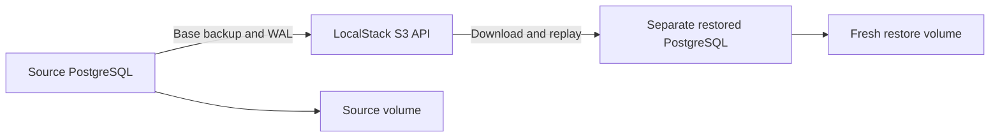

# Phase 1: an operator-managed database and a recovery drill

The dashboard you can use today is the complete Compose pipeline at
http://127.0.0.1:3101. Open a machine and watch its latest sensor values change
after a batch arrives, roughly once a minute. Those values are fictional, but
they travel through MQTT, SQS, PostgreSQL and the API. The public Firebase demo
still uses its browser simulation. The Kubernetes dashboard on port 3102 comes
with the next platform/application wiring step.

This step moves the database responsibilities into Kubernetes. It does not yet
install the application chart. Compose and Kubernetes have separate databases;
we have not moved your Compose readings into the Kubernetes database.

## Why a Deployment is not enough for PostgreSQL

A Deployment knows how to replace a failed Pod. It does not know when PostgreSQL
has finished recovering, which database is the primary, which certificates it
needs, or how to restore a physical backup.

An **operator** is a controller that understands those responsibilities.
CloudNativePG watches a **Cluster** object: a declaration of the PostgreSQL
system we want. This database Cluster is a custom Kubernetes resource; it is
different from the entire k3d Kubernetes cluster.

The operator creates the database Pod, persistent volume claim, Services,
certificates and limited instance-manager identity. We declare their desired
configuration in `infra/k8s/local/database.yaml`. We do not write a competing
Deployment or edit the generated Pod directly.

| Resource | Responsibility |
|---|---|
| CloudNativePG Cluster | PostgreSQL instance, storage, settings and lifecycle |
| ObjectStore | S3 endpoint, credential references and backup-sidecar budget |
| Backup | One requested base backup and its completion status |
| ScheduledBackup | A daily backup schedule, using six-field cron syntax |
| PersistentVolumeClaim (PVC) | Request for persistent storage |
| Service | Stable network address despite Pod replacement |
| cert-manager Certificate | Certificate issuance and renewal for the backup plugin |

## What we installed and why

CloudNativePG 1.30.1 uses chart 0.29.1. The Barman Cloud plugin 0.15.1 uses
chart 0.8.1. These are different version numbers: a chart packages a release.
cert-manager 1.21.2 issues the plugin's internal certificates, so it is a
prerequisite even before we configure the public HTTPS ingress.

`infra/k8s/local/operators.json` records archive URLs, SHA-256 checksums and
image digests. `scripts/setup-k8s-operators.mjs` downloads into ignored
`.tools/k8s/platform` on D:, checks the bytes, installs the operators and waits
for readiness. It watches only our local application namespace for databases.

The same script preloads the pinned Barman sidecar through the node's CRI
runtime. Our Cluster uses `imagePullPolicy: Never`, which also applies to the
operator's injected sidecar. Importing the application images alone left that
sidecar missing. An `ErrImageNeverPull` event identified the actual problem;
changing a memory allocation would not have fixed it.

We reuse the tested `kinetiq-postgres:18.6-1` image. It provides PostgreSQL 18.6,
pg_partman 5.5.0 and pg_cron 1.6.8. The installed pg_cron SQL extension reports
version `1.6`; that does not mean the OS package reverted to 1.6.0.

CloudNativePG replaces the image's Docker command. Therefore its Cluster
configuration explicitly sets pg_cron's preload library, target database,
background-worker mode, UTC timezone and connection limit. We set UID/GID 999
to match this image's PostgreSQL account. Successful initialization and recovery
are the compatibility evidence; an image name alone is insufficient.

## How a backup restores data

PostgreSQL records changes in its **write-ahead log**, or WAL. A **base backup**
copies the database files at a consistent starting point. WAL replay advances
those files through subsequent committed changes.



We configure gzip compression, one data-upload worker, two WAL-upload workers
and seven-day backup retention. `archive_timeout: 60s` encourages periodic WAL
archiving. It is a configuration value, not a measured one-minute recovery-point
guarantee: failed uploads, load and connectivity can increase the gap.

The recovery resource in `database-restore.yaml` refers to the source's backup
archive by `serverName: kinetiq-db`. It has a different Cluster name and receives
a fresh PVC. It does not mount the source PVC or use `pg_basebackup` against
the source Service. The drill compares volume identities as well as recovered
data, so accidentally checking the original database cannot count as a restore.

We also replace the original database Pod and verify the same PVC and data
remain. That proves retained-volume recovery on the existing node. It does not
prove that a new cloud server can reattach an old node-local volume. S3 recovery
remains the primary replacement-server path; the cloud volume spike is still
required before claiming reattachment works.

## Secrets, TLS and tenant boundaries

Local credentials are generated once under ignored `.tools/k8s/secrets` on D:.
The setup script reuses them. If that file is missing while the admin Secret
still exists, setup refuses to generate replacement passwords silently.

Kubernetes receives credentials through standard input. They are absent from
tracked YAML and command-line arguments. The LocalStack developer token comes
from the root `.env.local`. It never enters a frontend bundle. Local backup
credentials are literally `test`; they are emulator identities, not AWS keys.

Database setup/check Jobs run as UID 1000, with a read-only root filesystem,
dropped Linux capabilities and no mounted Kubernetes API token. Only these
administrative Jobs receive the superuser credential; the application chart
references distinct API and ingest Secrets.

CloudNativePG manages a database certificate authority. The checks mount only
its public CA certificate and verify the database hostname during TLS connection
setup. The database rejects plaintext TCP connections. The checks deliberately
try both plaintext and a wrong TLS hostname and require rejection. This prevents
an encrypted connection with disabled certificate validation from counting as
verified TLS. The application Services will use the same CA when wired next.

The checks also use the actual `@kinetiq/db` helpers to:

- Run migrations and seed twice without changing their result.
- Insert a device reading through ingest, then reject its duplicate as a new row.
- Read the twelve seeded machines under the demo tenant.
- Return no machines with missing tenant context or a different tenant.
- Clear tenant context on the very same pooled connection after commit.
- Reject a cross-tenant write at the database boundary.
- Check service roles are neither superusers nor able to bypass RLS.
- Check rows land in child partitions, both extensions exist and cron jobs exist.
- Compare a SHA-256 fingerprint of all persisted telemetry before and after recovery.

NetworkPolicies restrict the database's application ingress and allow its
operator, replication peers, DNS, Kubernetes API and S3 traffic. A complete
application network-denial acceptance check belongs to the whole-path step;
rendered policy YAML alone is not proof of every denied connection.

## The LocalStack limitation we actually found

Our Hobby account successfully supports S3 uploads, WAL archiving and PostgreSQL
restoration. It does **not** provide persistence. We uploaded a completed backup,
restarted the emulator with a PVC and `PERSISTENCE=1`, and found the objects had
disappeared. The [official persistence documentation](https://docs.localstack.cloud/aws/developer-tools/snapshots/persistence/)
lists that feature under Base and Ultimate plans.

We removed the ineffective persistence flag. The PVC caches emulator activation
data; it does not make Hobby S3 durable. The final recovery drill explicitly
proves a PostgreSQL restore through the S3 API while LocalStack runs. Restarting
LocalStack requires a new backup. A previous Backup resource can still say
`completed` even though the emulated objects are gone: completion status is
historical evidence, not a continuous integrity check.

LocalStack and PostgreSQL also live on the same laptop disk. Neither this test
nor a local PVC protects against losing that disk. Independent AWS S3 storage,
IAM/OIDC identity, encryption and real cloud recovery remain Phase 2 work. No
paid emulator upgrade or cloud infrastructure was created for this checkpoint.

LocalStack's upstream startup uses root and a writable filesystem. This is an
explicit local emulator exception, with no Docker socket, host ports or API
token, and no privilege escalation or Linux capabilities. It does not change
the restricted application Pod configuration.

## Run and inspect it

From the project root, with Docker running, stop Compose before starting Kubernetes:

```powershell
docker compose stop
npm run k8s:up
npm run k8s:images
npm run k8s:operators
npm run k8s:database
npm run k8s:database:verify
npm run k8s:kubectl -- get clusters,backups,pvc -n kinetiq-local
```

The drill creates unique check Jobs, a backup and a disposable restore Cluster.
It verifies recovered data before deleting that restore Cluster and only its
PVCs. It retains the source database and backup. A failed drill leaves evidence
available for inspection; it never falls back to reporting success against the
source database. The report is saved in ignored
`.tools/k8s/database-recovery-report.json`.

The database connection cap is 50. Local API and ingest pools need eight service
connections; two API replicas would need thirteen. Setup, operator, maintenance
and future services also need headroom. A cap does not reserve connections for
each service: pool budgets and observed peak use still matter.

Configured steady limits for this checkpoint are 896 MiB for the five operator
Pods, 512 MiB for PostgreSQL, 256 MiB for its backup sidecar and 1,024 MiB for
LocalStack: 2,688 MiB before Kubernetes itself. A temporary restore adds up to
768 MiB, and one check Job adds 256 MiB. Application Pods are not running in this
checkpoint. Keep the laptop's existing Docker allocation and separate Compose
from Kubernetes; do not overlap a restore drill with a full application rollout.

The final drill on 9 October 2026 checked twelve seeded machines and four
fixture telemetry rows. Base backup completion took 18.9 seconds; fresh-volume
restore and read checks took 85.2 seconds. These timings exclude tool/image
installation and are specific to this tiny dataset. The report recorded
distinct source and restore volume identities and identical telemetry hashes.
During an earlier restore, one Docker stats sample measured the node at
2.49 GiB, plus about 16 MiB for its proxy. This is an observation, not a
measured full-stack maximum or production recovery-time guarantee.

## Practice and interview questions

1. Inspect `get clusters,backups,pvc`. Which object describes the database,
   which describes one operation, and which describes its storage?
2. Explain why a `completed` backup status could coexist with missing S3 objects.
3. Explain why checking twelve machine rows is weaker than also comparing
   telemetry fingerprints and distinct volume identities.
4. Which failure does Pod replacement cover? Which failure requires independent
   S3 storage? Why is local-path storage insufficient for a fresh cloud node?
5. Where is a certificate authority different from a private key? Why can we
   mount the CA certificate in application Pods without giving them server keys?
6. Why is `ssl: true` weaker evidence than rejecting the wrong server hostname?
7. Trace how `withTenantTransaction` prevents pooled connections from leaking
   the previous tenant into the next request.

Upstream references: [CloudNativePG images](https://cloudnative-pg.io/docs/1.30/container_images/),
[Barman 0.15.1 installation](https://github.com/cloudnative-pg/plugin-barman-cloud/blob/v0.15.1/web/versioned_docs/version-0.15.1/installation.mdx),
[Barman 0.15.1 recovery examples](https://github.com/cloudnative-pg/plugin-barman-cloud/blob/v0.15.1/hack/examples/cluster-restore.yaml).
